# coach.db

## Description

Bundled read-only exercise catalog, built by scripts/db/build_db.py from db/source/*.json.

## Tables

| Name                                                        | Columns | Comment                                                                                                                                              | Type  |
| ----------------------------------------------------------- | ------- | ---------------------------------------------------------------------------------------------------------------------------------------------------- | ----- |
| [common_injuries](common_injuries.md)                       | 8       |                                                                                                                                                      | table |
| [equipment](equipment.md)                                   | 8       |                                                                                                                                                      | table |
| [exercise_aliases](exercise_aliases.md)                     | 6       |                                                                                                                                                      | table |
| [exercise_equipment](exercise_equipment.md)                 | 3       |                                                                                                                                                      | table |
| [exercise_injury_relevance](exercise_injury_relevance.md)   | 4       |                                                                                                                                                      | table |
| [exercise_movement_patterns](exercise_movement_patterns.md) | 2       |                                                                                                                                                      | table |
| [exercise_muscles](exercise_muscles.md)                     | 3       |                                                                                                                                                      | table |
| [exercise_phases](exercise_phases.md)                       | 4       |                                                                                                                                                      | table |
| [exercise_sport_relevance](exercise_sport_relevance.md)     | 9       |                                                                                                                                                      | table |
| [exercise_substitutions](exercise_substitutions.md)         | 5       |                                                                                                                                                      | table |
| [exercises](exercises.md)                                   | 51      | The catalog. Ids are pinned in db/source/exercises.json and copied into user.db and UserDefaults, so an id change repoints saved routines and plans. | table |
| [injury_sport_prevalence](injury_sport_prevalence.md)       | 4       |                                                                                                                                                      | table |
| [movement_patterns](movement_patterns.md)                   | 5       |                                                                                                                                                      | table |
| [muscle_groups](muscle_groups.md)                           | 6       |                                                                                                                                                      | table |
| [routine_exercises](routine_exercises.md)                   | 11      |                                                                                                                                                      | table |
| [routine_sports](routine_sports.md)                         | 2       |                                                                                                                                                      | table |
| [routines](routines.md)                                     | 18      |                                                                                                                                                      | table |
| [sport_categories](sport_categories.md)                     | 15      |                                                                                                                                                      | table |
| [sport_recovery_profiles](sport_recovery_profiles.md)       | 7       |                                                                                                                                                      | table |
| [sport_movements](sport_movements.md)                       | 14      | Season-aware movement pool. `sport` is a sport_categories slug with no FK.                                                                           | table |

## Relations

```mermaid
erDiagram

"exercise_aliases" }o--|| "exercises" : "FOREIGN KEY (exercise_id) REFERENCES exercises (id) ON UPDATE NO ACTION ON DELETE CASCADE MATCH NONE"
"exercise_equipment" |o--|| "equipment" : "FOREIGN KEY (equipment_id) REFERENCES equipment (id) ON UPDATE NO ACTION ON DELETE CASCADE MATCH NONE"
"exercise_equipment" |o--|| "exercises" : "FOREIGN KEY (exercise_id) REFERENCES exercises (id) ON UPDATE NO ACTION ON DELETE CASCADE MATCH NONE"
"exercise_injury_relevance" |o--|| "common_injuries" : "FOREIGN KEY (injury_id) REFERENCES common_injuries (id) ON UPDATE NO ACTION ON DELETE CASCADE MATCH NONE"
"exercise_injury_relevance" |o--|| "exercises" : "FOREIGN KEY (exercise_id) REFERENCES exercises (id) ON UPDATE NO ACTION ON DELETE CASCADE MATCH NONE"
"exercise_movement_patterns" |o--|| "movement_patterns" : "FOREIGN KEY (movement_pattern_id) REFERENCES movement_patterns (id) ON UPDATE NO ACTION ON DELETE CASCADE MATCH NONE"
"exercise_movement_patterns" |o--|| "exercises" : "FOREIGN KEY (exercise_id) REFERENCES exercises (id) ON UPDATE NO ACTION ON DELETE CASCADE MATCH NONE"
"exercise_muscles" |o--|| "muscle_groups" : "FOREIGN KEY (muscle_group_id) REFERENCES muscle_groups (id) ON UPDATE NO ACTION ON DELETE CASCADE MATCH NONE"
"exercise_muscles" |o--|| "exercises" : "FOREIGN KEY (exercise_id) REFERENCES exercises (id) ON UPDATE NO ACTION ON DELETE CASCADE MATCH NONE"
"exercise_phases" |o--|| "exercises" : "FOREIGN KEY (exercise_id) REFERENCES exercises (id) ON UPDATE NO ACTION ON DELETE CASCADE MATCH NONE"
"exercise_sport_relevance" |o--|| "sport_categories" : "FOREIGN KEY (sport_id) REFERENCES sport_categories (id) ON UPDATE NO ACTION ON DELETE CASCADE MATCH NONE"
"exercise_sport_relevance" |o--|| "exercises" : "FOREIGN KEY (exercise_id) REFERENCES exercises (id) ON UPDATE NO ACTION ON DELETE CASCADE MATCH NONE"
"exercise_substitutions" |o--|| "exercises" : "FOREIGN KEY (substitute_id) REFERENCES exercises (id) ON UPDATE NO ACTION ON DELETE CASCADE MATCH NONE"
"exercise_substitutions" |o--|| "exercises" : "FOREIGN KEY (exercise_id) REFERENCES exercises (id) ON UPDATE NO ACTION ON DELETE CASCADE MATCH NONE"
"injury_sport_prevalence" |o--|| "sport_categories" : "FOREIGN KEY (sport_id) REFERENCES sport_categories (id) ON UPDATE NO ACTION ON DELETE CASCADE MATCH NONE"
"injury_sport_prevalence" |o--|| "common_injuries" : "FOREIGN KEY (injury_id) REFERENCES common_injuries (id) ON UPDATE NO ACTION ON DELETE CASCADE MATCH NONE"
"muscle_groups" }o--o| "muscle_groups" : "FOREIGN KEY (parent_id) REFERENCES muscle_groups (id) ON UPDATE NO ACTION ON DELETE NO ACTION MATCH NONE"
"routine_exercises" }o--|| "exercises" : "FOREIGN KEY (exercise_id) REFERENCES exercises (id) ON UPDATE NO ACTION ON DELETE CASCADE MATCH NONE"
"routine_exercises" }o--|| "routines" : "FOREIGN KEY (routine_id) REFERENCES routines (id) ON UPDATE NO ACTION ON DELETE CASCADE MATCH NONE"
"routine_sports" |o--|| "sport_categories" : "FOREIGN KEY (sport_id) REFERENCES sport_categories (id) ON UPDATE NO ACTION ON DELETE CASCADE MATCH NONE"
"routine_sports" |o--|| "routines" : "FOREIGN KEY (routine_id) REFERENCES routines (id) ON UPDATE NO ACTION ON DELETE CASCADE MATCH NONE"
"sport_categories" }o--o| "sport_categories" : "FOREIGN KEY (parent_id) REFERENCES sport_categories (id) ON UPDATE NO ACTION ON DELETE NO ACTION MATCH NONE"
"sport_recovery_profiles" |o--o| "sport_categories" : "FOREIGN KEY (sport_id) REFERENCES sport_categories (id) ON UPDATE NO ACTION ON DELETE CASCADE MATCH NONE"
"sport_movements" }o--|| "exercises" : "FOREIGN KEY (exercise_id) REFERENCES exercises (id) ON UPDATE NO ACTION ON DELETE CASCADE MATCH NONE"
"sport_movements" }o--|| "sport_categories" : "text join on slug, no FK (sport_movements.sport)"

"common_injuries" {
  INTEGER id
  TEXT name
  TEXT slug
  TEXT body_region
  TEXT description
  TEXT mechanism
  TEXT typical_recovery
  TEXT created_at
}
"equipment" {
  INTEGER id
  TEXT name
  TEXT slug
  TEXT category
  TEXT portability
  TEXT estimated_cost
  INTEGER home_gym_friendly
  TEXT created_at
}
"exercise_aliases" {
  INTEGER id
  INTEGER exercise_id FK
  TEXT alias
  TEXT source
  TEXT notes
  TEXT created_at
}
"exercise_equipment" {
  INTEGER exercise_id PK
  INTEGER equipment_id PK
  INTEGER is_required
}
"exercise_injury_relevance" {
  INTEGER exercise_id PK
  INTEGER injury_id PK
  TEXT role PK
  TEXT notes
}
"exercise_movement_patterns" {
  INTEGER exercise_id PK
  INTEGER movement_pattern_id PK
}
"exercise_muscles" {
  INTEGER exercise_id PK
  INTEGER muscle_group_id PK
  TEXT role
}
"exercise_phases" {
  INTEGER exercise_id PK
  TEXT phase PK
  TEXT priority
  TEXT volume_guidance
}
"exercise_sport_relevance" {
  INTEGER exercise_id PK
  INTEGER sport_id PK
  REAL relevance_score
  TEXT specificity
  TEXT support_role PK
  TEXT season_emphasis
  REAL in_season_volume_modifier
  REAL off_season_volume_modifier
  TEXT notes
}
"exercise_substitutions" {
  INTEGER exercise_id PK
  INTEGER substitute_id PK
  TEXT context PK
  REAL similarity_score
  TEXT notes
}
"exercises" {
  INTEGER id
  TEXT name
  TEXT slug
  TEXT description
  TEXT instructions
  TEXT cues
  TEXT difficulty
  TEXT modality
  TEXT movement_plane
  TEXT energy_system
  TEXT contraction_type
  INTEGER is_unilateral
  INTEGER is_compound
  TEXT environment
  INTEGER default_sets
  TEXT default_reps
  TEXT default_rest
  TEXT default_tempo
  TEXT default_duration
  TEXT time_efficient_variation
  TEXT home_variation
  TEXT age_considerations
  TEXT desk_worker_notes
  INTEGER recovery_demand
  INTEGER cns_load
  TEXT intensity_category
  TEXT fatigue_type
  TEXT swap_group
  INTEGER low_energy_suitable
  INTEGER pre_event_safe
  INTEGER warmup_compatible
  TEXT injury_prevention_notes
  TEXT contraindications
  TEXT pt_rehab_relevance
  TEXT common_compensations
  TEXT regression
  TEXT progression
  TEXT video_url
  TEXT image_url
  TEXT thumbnail_url
  TEXT source_video_attribution
  TEXT image_source
  TEXT image_license
  TEXT image_attribution
  TEXT source_name
  TEXT source_url
  TEXT source_type
  INTEGER source_year
  TEXT tags
  TEXT created_at
  TEXT updated_at
}
"injury_sport_prevalence" {
  INTEGER injury_id PK
  INTEGER sport_id PK
  TEXT prevalence
  TEXT notes
}
"movement_patterns" {
  INTEGER id
  TEXT name
  TEXT slug
  TEXT description
  TEXT body_region
}
"muscle_groups" {
  INTEGER id
  TEXT name
  TEXT slug
  INTEGER parent_id FK
  TEXT body_region
  TEXT created_at
}
"routine_exercises" {
  INTEGER id
  INTEGER routine_id FK
  INTEGER exercise_id FK
  INTEGER position
  INTEGER superset_group
  INTEGER sets
  TEXT reps
  TEXT rest
  TEXT tempo
  TEXT duration
  TEXT notes
}
"routine_sports" {
  INTEGER routine_id PK
  INTEGER sport_id PK
}
"routines" {
  INTEGER id
  TEXT name
  TEXT slug
  TEXT description
  TEXT goal
  TEXT difficulty
  TEXT phase
  INTEGER duration_minutes
  TEXT frequency
  TEXT environment
  TEXT time_commitment
  TEXT ideal_schedule
  TEXT notes
  TEXT source_name
  TEXT source_url
  TEXT tags
  TEXT created_at
  TEXT updated_at
}
"sport_categories" {
  INTEGER id
  TEXT name
  TEXT slug
  TEXT description
  INTEGER parent_id FK
  INTEGER depth
  INTEGER sort_order
  INTEGER typical_session_minutes
  TEXT common_training_days
  TEXT peak_season
  TEXT common_injuries
  TEXT governing_body
  TEXT unsupported_reason
  TEXT created_at
  TEXT updated_at
}
"sport_recovery_profiles" {
  INTEGER sport_id FK
  INTEGER typical_recovery_hours
  TEXT primary_fatigue_type
  TEXT muscles_loaded
  TEXT avoid_before_session
  TEXT ideal_supplement_timing
  TEXT notes
}
"sport_movements" {
  INTEGER id
  TEXT slug
  TEXT name
  TEXT sport
  INTEGER exercise_id FK
  TEXT demands
  TEXT allowed_phases
  TEXT allowed_variants
  INTEGER fatigue_cost
  TEXT min_experience
  TEXT injury_caution
  INTEGER protocol_sets
  TEXT protocol_reps
  INTEGER protocol_rest_seconds
}
```

---

> Generated by [tbls](https://github.com/k1LoW/tbls)
