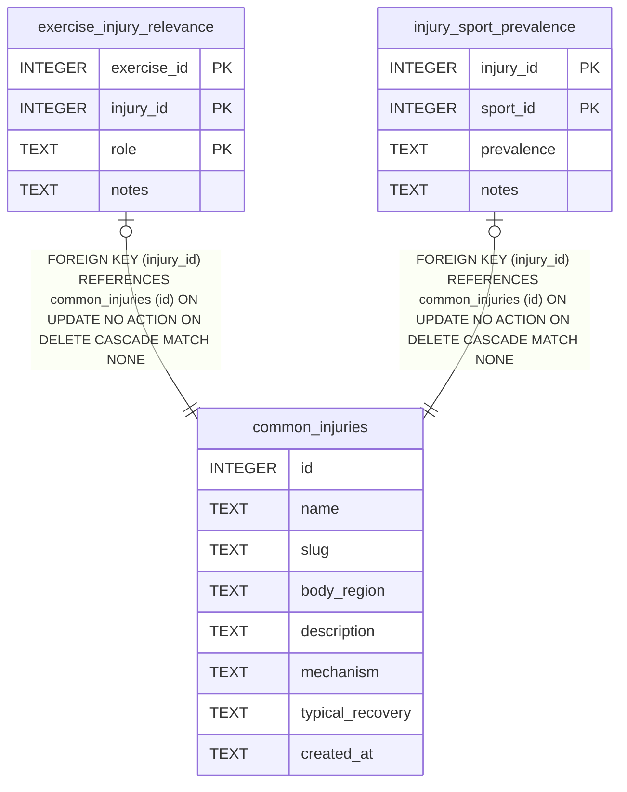

# common_injuries

## Description

<details>
<summary><strong>Table Definition</strong></summary>

```sql
CREATE TABLE common_injuries (
  id                       INTEGER PRIMARY KEY,
  name                     TEXT NOT NULL UNIQUE,
  slug                     TEXT NOT NULL UNIQUE,
  body_region              TEXT,
  description              TEXT,
  mechanism                TEXT,
  typical_recovery         TEXT,
  created_at               TEXT DEFAULT (datetime('now'))
)
```

</details>

## Columns

| Name             | Type    | Default         | Nullable | Children                                                                                                        | Comment |
| ---------------- | ------- | --------------- | -------- | --------------------------------------------------------------------------------------------------------------- | ------- |
| id               | INTEGER |                 | true     | [exercise_injury_relevance](exercise_injury_relevance.md) [injury_sport_prevalence](injury_sport_prevalence.md) |         |
| name             | TEXT    |                 | false    |                                                                                                                 |         |
| slug             | TEXT    |                 | false    |                                                                                                                 |         |
| body_region      | TEXT    |                 | true     |                                                                                                                 |         |
| description      | TEXT    |                 | true     |                                                                                                                 |         |
| mechanism        | TEXT    |                 | true     |                                                                                                                 |         |
| typical_recovery | TEXT    |                 | true     |                                                                                                                 |         |
| created_at       | TEXT    | datetime('now') | true     |                                                                                                                 |         |

## Constraints

| Name                               | Type        | Definition       |
| ---------------------------------- | ----------- | ---------------- |
| id                                 | PRIMARY KEY | PRIMARY KEY (id) |
| sqlite_autoindex_common_injuries_2 | UNIQUE      | UNIQUE (slug)    |
| sqlite_autoindex_common_injuries_1 | UNIQUE      | UNIQUE (name)    |

## Indexes

| Name                               | Definition    |
| ---------------------------------- | ------------- |
| sqlite_autoindex_common_injuries_2 | UNIQUE (slug) |
| sqlite_autoindex_common_injuries_1 | UNIQUE (name) |

## Relations



---

> Generated by [tbls](https://github.com/k1LoW/tbls)
