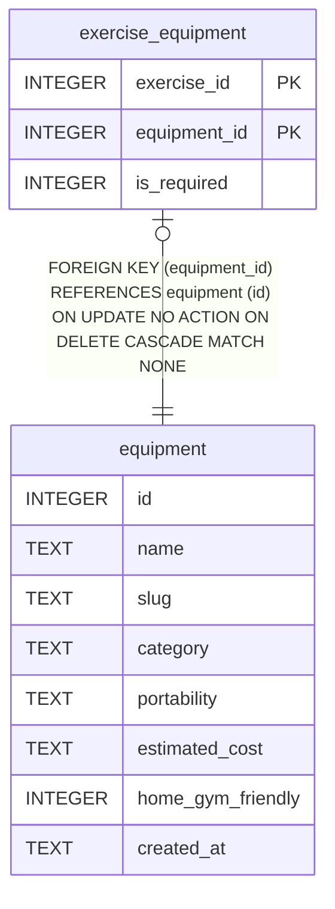

# equipment

## Description

<details>
<summary><strong>Table Definition</strong></summary>

```sql
CREATE TABLE equipment (
  id                       INTEGER PRIMARY KEY,
  name                     TEXT NOT NULL UNIQUE,
  slug                     TEXT NOT NULL UNIQUE,
  category                 TEXT,
  portability              TEXT CHECK (portability IN ('portable','gym_only','outdoor_only','any')),
  estimated_cost           TEXT CHECK (estimated_cost IN ('low','medium','high')),
  home_gym_friendly        INTEGER DEFAULT 0 CHECK (home_gym_friendly IN (0,1)),
  created_at               TEXT DEFAULT (datetime('now'))
)
```

</details>

## Columns

| Name              | Type    | Default         | Nullable | Children                                    | Comment |
| ----------------- | ------- | --------------- | -------- | ------------------------------------------- | ------- |
| id                | INTEGER |                 | true     | [exercise_equipment](exercise_equipment.md) |         |
| name              | TEXT    |                 | false    |                                             |         |
| slug              | TEXT    |                 | false    |                                             |         |
| category          | TEXT    |                 | true     |                                             |         |
| portability       | TEXT    |                 | true     |                                             |         |
| estimated_cost    | TEXT    |                 | true     |                                             |         |
| home_gym_friendly | INTEGER | 0               | true     |                                             |         |
| created_at        | TEXT    | datetime('now') | true     |                                             |         |

## Constraints

| Name                         | Type        | Definition                                                          |
| ---------------------------- | ----------- | ------------------------------------------------------------------- |
| id                           | PRIMARY KEY | PRIMARY KEY (id)                                                    |
| sqlite_autoindex_equipment_2 | UNIQUE      | UNIQUE (slug)                                                       |
| sqlite_autoindex_equipment_1 | UNIQUE      | UNIQUE (name)                                                       |
| -                            | CHECK       | CHECK (portability IN ('portable','gym_only','outdoor_only','any')) |
| -                            | CHECK       | CHECK (estimated_cost IN ('low','medium','high'))                   |
| -                            | CHECK       | CHECK (home_gym_friendly IN (0,1))                                  |

## Indexes

| Name                         | Definition    |
| ---------------------------- | ------------- |
| sqlite_autoindex_equipment_2 | UNIQUE (slug) |
| sqlite_autoindex_equipment_1 | UNIQUE (name) |

## Relations



---

> Generated by [tbls](https://github.com/k1LoW/tbls)
