# exercise_aliases

## Description

<details>
<summary><strong>Table Definition</strong></summary>

```sql
CREATE TABLE exercise_aliases (
  id            INTEGER PRIMARY KEY AUTOINCREMENT,
  exercise_id   INTEGER NOT NULL REFERENCES exercises(id) ON DELETE CASCADE,
  alias         TEXT NOT NULL,
  source        TEXT CHECK (source IN (
                  'common_name',    -- everyday gym name ("RDL", "DL")
                  'sport_name',     -- discipline-specific ("crimp grip", "front lever")
                  'brand',          -- equipment-brand name ("ViPR shovel", "Bulgarian bag")
                  'historical',     -- older name still in literature
                  'misspelling',    -- common typo we want to forgive
                  'translation'     -- non-English label
                )),
  notes         TEXT,
  created_at    TEXT DEFAULT (datetime('now'))
)
```

</details>

## Columns

| Name        | Type    | Default         | Nullable | Children | Parents                   | Comment |
| ----------- | ------- | --------------- | -------- | -------- | ------------------------- | ------- |
| id          | INTEGER |                 | true     |          |                           |         |
| exercise_id | INTEGER |                 | false    |          | [exercises](exercises.md) |         |
| alias       | TEXT    |                 | false    |          |                           |         |
| source      | TEXT    |                 | true     |          |                           |         |
| notes       | TEXT    |                 | true     |          |                           |         |
| created_at  | TEXT    | datetime('now') | true     |          |                           |         |

## Constraints

| Name                  | Type        | Definition                                                                                                                                                                                                                                                                                                                                       |
| --------------------- | ----------- | ------------------------------------------------------------------------------------------------------------------------------------------------------------------------------------------------------------------------------------------------------------------------------------------------------------------------------------------------ |
| id                    | PRIMARY KEY | PRIMARY KEY (id)                                                                                                                                                                                                                                                                                                                                 |
| - (Foreign key ID: 0) | FOREIGN KEY | FOREIGN KEY (exercise_id) REFERENCES exercises (id) ON UPDATE NO ACTION ON DELETE CASCADE MATCH NONE                                                                                                                                                                                                                                             |
| -                     | CHECK       | CHECK (source IN ( 'common_name', -- everyday gym name ("RDL", "DL") 'sport_name', -- discipline-specific ("crimp grip", "front lever") 'brand', -- equipment-brand name ("ViPR shovel", "Bulgarian bag") 'historical', -- older name still in literature 'misspelling', -- common typo we want to forgive 'translation' -- non-English label )) |

## Indexes

| Name                          | Definition                                                                                                    |
| ----------------------------- | ------------------------------------------------------------------------------------------------------------- |
| idx_exercise_aliases_unique   | CREATE UNIQUE INDEX idx_exercise_aliases_unique<br />  ON exercise_aliases(exercise_id, alias COLLATE NOCASE) |
| idx_exercise_aliases_exercise | CREATE INDEX idx_exercise_aliases_exercise ON exercise_aliases(exercise_id)                                   |
| idx_exercise_aliases_alias    | CREATE INDEX idx_exercise_aliases_alias    ON exercise_aliases(alias COLLATE NOCASE)                          |

## Relations

```mermaid
erDiagram

"exercise_aliases" }o--|| "exercises" : "FOREIGN KEY (exercise_id) REFERENCES exercises (id) ON UPDATE NO ACTION ON DELETE CASCADE MATCH NONE"

"exercise_aliases" {
  INTEGER id
  INTEGER exercise_id FK
  TEXT alias
  TEXT source
  TEXT notes
  TEXT created_at
}
"exercises" {
  INTEGER id
  TEXT name
  TEXT slug
  TEXT description
  TEXT instructions
  TEXT cues
  TEXT difficulty
  TEXT modality
  TEXT movement_plane
  TEXT energy_system
  TEXT contraction_type
  INTEGER is_unilateral
  INTEGER is_compound
  TEXT environment
  INTEGER default_sets
  TEXT default_reps
  TEXT default_rest
  TEXT default_tempo
  TEXT default_duration
  TEXT time_efficient_variation
  TEXT home_variation
  TEXT age_considerations
  TEXT desk_worker_notes
  INTEGER recovery_demand
  INTEGER cns_load
  TEXT intensity_category
  TEXT fatigue_type
  TEXT swap_group
  INTEGER low_energy_suitable
  INTEGER pre_event_safe
  INTEGER warmup_compatible
  TEXT injury_prevention_notes
  TEXT contraindications
  TEXT pt_rehab_relevance
  TEXT common_compensations
  TEXT regression
  TEXT progression
  TEXT video_url
  TEXT image_url
  TEXT thumbnail_url
  TEXT source_video_attribution
  TEXT image_source
  TEXT image_license
  TEXT image_attribution
  TEXT source_name
  TEXT source_url
  TEXT source_type
  INTEGER source_year
  TEXT tags
  TEXT created_at
  TEXT updated_at
}
```



---

> Generated by [tbls](https://github.com/k1LoW/tbls)
