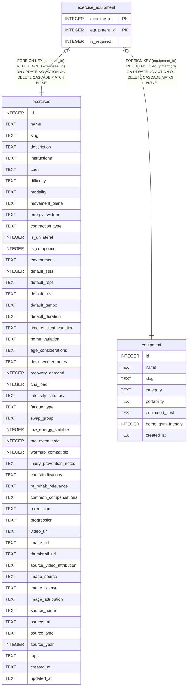

# exercise_equipment

## Description

<details>
<summary><strong>Table Definition</strong></summary>

```sql
CREATE TABLE exercise_equipment (
  exercise_id     INTEGER NOT NULL REFERENCES exercises(id) ON DELETE CASCADE,
  equipment_id    INTEGER NOT NULL REFERENCES equipment(id) ON DELETE CASCADE,
  is_required     INTEGER DEFAULT 1 CHECK (is_required IN (0,1)),
  PRIMARY KEY (exercise_id, equipment_id)
)
```

</details>

## Columns

| Name         | Type    | Default | Nullable | Children | Parents                   | Comment |
| ------------ | ------- | ------- | -------- | -------- | ------------------------- | ------- |
| exercise_id  | INTEGER |         | false    |          | [exercises](exercises.md) |         |
| equipment_id | INTEGER |         | false    |          | [equipment](equipment.md) |         |
| is_required  | INTEGER | 1       | true     |          |                           |         |

## Constraints

| Name                                  | Type        | Definition                                                                                            |
| ------------------------------------- | ----------- | ----------------------------------------------------------------------------------------------------- |
| exercise_id                           | PRIMARY KEY | PRIMARY KEY (exercise_id)                                                                             |
| equipment_id                          | PRIMARY KEY | PRIMARY KEY (equipment_id)                                                                            |
| - (Foreign key ID: 0)                 | FOREIGN KEY | FOREIGN KEY (equipment_id) REFERENCES equipment (id) ON UPDATE NO ACTION ON DELETE CASCADE MATCH NONE |
| - (Foreign key ID: 1)                 | FOREIGN KEY | FOREIGN KEY (exercise_id) REFERENCES exercises (id) ON UPDATE NO ACTION ON DELETE CASCADE MATCH NONE  |
| sqlite_autoindex_exercise_equipment_1 | PRIMARY KEY | PRIMARY KEY (exercise_id, equipment_id)                                                               |
| -                                     | CHECK       | CHECK (is_required IN (0,1))                                                                          |

## Indexes

| Name                                  | Definition                                                                         |
| ------------------------------------- | ---------------------------------------------------------------------------------- |
| idx_ee_equipment                      | CREATE INDEX idx_ee_equipment                  ON exercise_equipment(equipment_id) |
| sqlite_autoindex_exercise_equipment_1 | PRIMARY KEY (exercise_id, equipment_id)                                            |

## Relations



---

> Generated by [tbls](https://github.com/k1LoW/tbls)
