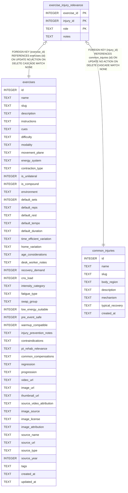

# exercise_injury_relevance

## Description

<details>
<summary><strong>Table Definition</strong></summary>

```sql
CREATE TABLE exercise_injury_relevance (
  exercise_id     INTEGER NOT NULL REFERENCES exercises(id) ON DELETE CASCADE,
  injury_id       INTEGER NOT NULL REFERENCES common_injuries(id) ON DELETE CASCADE,
  role            TEXT NOT NULL CHECK (role IN ('prehab','rehab_early','rehab_late','contraindicated')),
  notes           TEXT,
  PRIMARY KEY (exercise_id, injury_id, role)
)
```

</details>

## Columns

| Name        | Type    | Default | Nullable | Children | Parents                               | Comment |
| ----------- | ------- | ------- | -------- | -------- | ------------------------------------- | ------- |
| exercise_id | INTEGER |         | false    |          | [exercises](exercises.md)             |         |
| injury_id   | INTEGER |         | false    |          | [common_injuries](common_injuries.md) |         |
| role        | TEXT    |         | false    |          |                                       |         |
| notes       | TEXT    |         | true     |          |                                       |         |

## Constraints

| Name                                         | Type        | Definition                                                                                               |
| -------------------------------------------- | ----------- | -------------------------------------------------------------------------------------------------------- |
| exercise_id                                  | PRIMARY KEY | PRIMARY KEY (exercise_id)                                                                                |
| injury_id                                    | PRIMARY KEY | PRIMARY KEY (injury_id)                                                                                  |
| role                                         | PRIMARY KEY | PRIMARY KEY (role)                                                                                       |
| - (Foreign key ID: 0)                        | FOREIGN KEY | FOREIGN KEY (injury_id) REFERENCES common_injuries (id) ON UPDATE NO ACTION ON DELETE CASCADE MATCH NONE |
| - (Foreign key ID: 1)                        | FOREIGN KEY | FOREIGN KEY (exercise_id) REFERENCES exercises (id) ON UPDATE NO ACTION ON DELETE CASCADE MATCH NONE     |
| sqlite_autoindex_exercise_injury_relevance_1 | PRIMARY KEY | PRIMARY KEY (exercise_id, injury_id, role)                                                               |
| -                                            | CHECK       | CHECK (role IN ('prehab','rehab_early','rehab_late','contraindicated'))                                  |

## Indexes

| Name                                         | Definition                                                                             |
| -------------------------------------------- | -------------------------------------------------------------------------------------- |
| idx_exinj_injury                             | CREATE INDEX idx_exinj_injury                  ON exercise_injury_relevance(injury_id) |
| sqlite_autoindex_exercise_injury_relevance_1 | PRIMARY KEY (exercise_id, injury_id, role)                                             |

## Relations



---

> Generated by [tbls](https://github.com/k1LoW/tbls)
