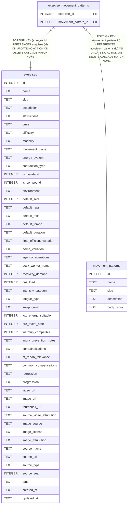

# exercise_movement_patterns

## Description

<details>
<summary><strong>Table Definition</strong></summary>

```sql
CREATE TABLE exercise_movement_patterns (
  exercise_id         INTEGER NOT NULL REFERENCES exercises(id) ON DELETE CASCADE,
  movement_pattern_id INTEGER NOT NULL REFERENCES movement_patterns(id) ON DELETE CASCADE,
  PRIMARY KEY (exercise_id, movement_pattern_id)
)
```

</details>

## Columns

| Name                | Type    | Default | Nullable | Children | Parents                                   | Comment |
| ------------------- | ------- | ------- | -------- | -------- | ----------------------------------------- | ------- |
| exercise_id         | INTEGER |         | false    |          | [exercises](exercises.md)                 |         |
| movement_pattern_id | INTEGER |         | false    |          | [movement_patterns](movement_patterns.md) |         |

## Constraints

| Name                                          | Type        | Definition                                                                                                           |
| --------------------------------------------- | ----------- | -------------------------------------------------------------------------------------------------------------------- |
| exercise_id                                   | PRIMARY KEY | PRIMARY KEY (exercise_id)                                                                                            |
| movement_pattern_id                           | PRIMARY KEY | PRIMARY KEY (movement_pattern_id)                                                                                    |
| - (Foreign key ID: 0)                         | FOREIGN KEY | FOREIGN KEY (movement_pattern_id) REFERENCES movement_patterns (id) ON UPDATE NO ACTION ON DELETE CASCADE MATCH NONE |
| - (Foreign key ID: 1)                         | FOREIGN KEY | FOREIGN KEY (exercise_id) REFERENCES exercises (id) ON UPDATE NO ACTION ON DELETE CASCADE MATCH NONE                 |
| sqlite_autoindex_exercise_movement_patterns_1 | PRIMARY KEY | PRIMARY KEY (exercise_id, movement_pattern_id)                                                                       |

## Indexes

| Name                                          | Definition                                     |
| --------------------------------------------- | ---------------------------------------------- |
| sqlite_autoindex_exercise_movement_patterns_1 | PRIMARY KEY (exercise_id, movement_pattern_id) |

## Relations



---

> Generated by [tbls](https://github.com/k1LoW/tbls)
