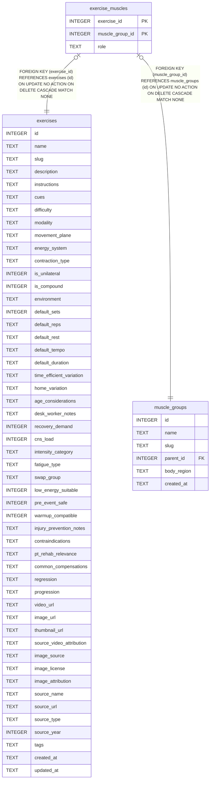

# exercise_muscles

## Description

<details>
<summary><strong>Table Definition</strong></summary>

```sql
CREATE TABLE exercise_muscles (
  exercise_id     INTEGER NOT NULL REFERENCES exercises(id) ON DELETE CASCADE,
  muscle_group_id INTEGER NOT NULL REFERENCES muscle_groups(id) ON DELETE CASCADE,
  role            TEXT NOT NULL CHECK (role IN ('primary','secondary','stabilizer')),
  PRIMARY KEY (exercise_id, muscle_group_id)
)
```

</details>

## Columns

| Name            | Type    | Default | Nullable | Children | Parents                           | Comment |
| --------------- | ------- | ------- | -------- | -------- | --------------------------------- | ------- |
| exercise_id     | INTEGER |         | false    |          | [exercises](exercises.md)         |         |
| muscle_group_id | INTEGER |         | false    |          | [muscle_groups](muscle_groups.md) |         |
| role            | TEXT    |         | false    |          |                                   |         |

## Constraints

| Name                                | Type        | Definition                                                                                                   |
| ----------------------------------- | ----------- | ------------------------------------------------------------------------------------------------------------ |
| exercise_id                         | PRIMARY KEY | PRIMARY KEY (exercise_id)                                                                                    |
| muscle_group_id                     | PRIMARY KEY | PRIMARY KEY (muscle_group_id)                                                                                |
| - (Foreign key ID: 0)               | FOREIGN KEY | FOREIGN KEY (muscle_group_id) REFERENCES muscle_groups (id) ON UPDATE NO ACTION ON DELETE CASCADE MATCH NONE |
| - (Foreign key ID: 1)               | FOREIGN KEY | FOREIGN KEY (exercise_id) REFERENCES exercises (id) ON UPDATE NO ACTION ON DELETE CASCADE MATCH NONE         |
| sqlite_autoindex_exercise_muscles_1 | PRIMARY KEY | PRIMARY KEY (exercise_id, muscle_group_id)                                                                   |
| -                                   | CHECK       | CHECK (role IN ('primary','secondary','stabilizer'))                                                         |

## Indexes

| Name                                | Definition                                                                          |
| ----------------------------------- | ----------------------------------------------------------------------------------- |
| idx_em_muscle                       | CREATE INDEX idx_em_muscle                     ON exercise_muscles(muscle_group_id) |
| sqlite_autoindex_exercise_muscles_1 | PRIMARY KEY (exercise_id, muscle_group_id)                                          |

## Relations



---

> Generated by [tbls](https://github.com/k1LoW/tbls)
