# exercise_phases

## Description

<details>
<summary><strong>Table Definition</strong></summary>

```sql
CREATE TABLE exercise_phases (
  exercise_id     INTEGER NOT NULL REFERENCES exercises(id) ON DELETE CASCADE,
  phase           TEXT NOT NULL CHECK (phase IN ('off_season','base','build','peak','race','recovery','maintenance')),
  priority        TEXT CHECK (priority IN ('primary','supplementary','optional')),
  volume_guidance TEXT,
  PRIMARY KEY (exercise_id, phase)
)
```

</details>

## Columns

| Name            | Type    | Default | Nullable | Children | Parents                   | Comment |
| --------------- | ------- | ------- | -------- | -------- | ------------------------- | ------- |
| exercise_id     | INTEGER |         | false    |          | [exercises](exercises.md) |         |
| phase           | TEXT    |         | false    |          |                           |         |
| priority        | TEXT    |         | true     |          |                           |         |
| volume_guidance | TEXT    |         | true     |          |                           |         |

## Constraints

| Name                               | Type        | Definition                                                                                           |
| ---------------------------------- | ----------- | ---------------------------------------------------------------------------------------------------- |
| exercise_id                        | PRIMARY KEY | PRIMARY KEY (exercise_id)                                                                            |
| phase                              | PRIMARY KEY | PRIMARY KEY (phase)                                                                                  |
| - (Foreign key ID: 0)              | FOREIGN KEY | FOREIGN KEY (exercise_id) REFERENCES exercises (id) ON UPDATE NO ACTION ON DELETE CASCADE MATCH NONE |
| sqlite_autoindex_exercise_phases_1 | PRIMARY KEY | PRIMARY KEY (exercise_id, phase)                                                                     |
| -                                  | CHECK       | CHECK (phase IN ('off_season','base','build','peak','race','recovery','maintenance'))                |
| -                                  | CHECK       | CHECK (priority IN ('primary','supplementary','optional'))                                           |

## Indexes

| Name                               | Definition                       |
| ---------------------------------- | -------------------------------- |
| sqlite_autoindex_exercise_phases_1 | PRIMARY KEY (exercise_id, phase) |

## Relations

```mermaid
erDiagram

"exercise_phases" |o--|| "exercises" : "FOREIGN KEY (exercise_id) REFERENCES exercises (id) ON UPDATE NO ACTION ON DELETE CASCADE MATCH NONE"

"exercise_phases" {
  INTEGER exercise_id PK
  TEXT phase PK
  TEXT priority
  TEXT volume_guidance
}
"exercises" {
  INTEGER id
  TEXT name
  TEXT slug
  TEXT description
  TEXT instructions
  TEXT cues
  TEXT difficulty
  TEXT modality
  TEXT movement_plane
  TEXT energy_system
  TEXT contraction_type
  INTEGER is_unilateral
  INTEGER is_compound
  TEXT environment
  INTEGER default_sets
  TEXT default_reps
  TEXT default_rest
  TEXT default_tempo
  TEXT default_duration
  TEXT time_efficient_variation
  TEXT home_variation
  TEXT age_considerations
  TEXT desk_worker_notes
  INTEGER recovery_demand
  INTEGER cns_load
  TEXT intensity_category
  TEXT fatigue_type
  TEXT swap_group
  INTEGER low_energy_suitable
  INTEGER pre_event_safe
  INTEGER warmup_compatible
  TEXT injury_prevention_notes
  TEXT contraindications
  TEXT pt_rehab_relevance
  TEXT common_compensations
  TEXT regression
  TEXT progression
  TEXT video_url
  TEXT image_url
  TEXT thumbnail_url
  TEXT source_video_attribution
  TEXT image_source
  TEXT image_license
  TEXT image_attribution
  TEXT source_name
  TEXT source_url
  TEXT source_type
  INTEGER source_year
  TEXT tags
  TEXT created_at
  TEXT updated_at
}
```



---

> Generated by [tbls](https://github.com/k1LoW/tbls)
