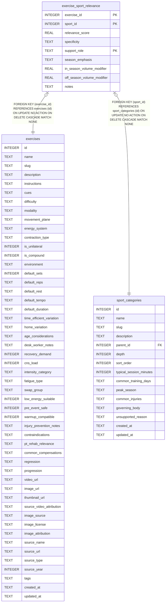

# exercise_sport_relevance

## Description

<details>
<summary><strong>Table Definition</strong></summary>

```sql
CREATE TABLE exercise_sport_relevance (
  exercise_id                INTEGER NOT NULL REFERENCES exercises(id) ON DELETE CASCADE,
  sport_id                   INTEGER NOT NULL REFERENCES sport_categories(id) ON DELETE CASCADE,
  relevance_score            REAL NOT NULL DEFAULT 0.5 CHECK (relevance_score BETWEEN 0.0 AND 1.0),
  specificity                TEXT CHECK (specificity IN ('general','related','highly_specific')),
  support_role               TEXT NOT NULL CHECK (support_role IN (
                               'direct_strength','antagonist','prehab','mobility',
                               'power','conditioning','general_foundation','recovery')),
  season_emphasis            TEXT,  -- JSON array: any of pre_season, in_season, off_season, all
  in_season_volume_modifier  REAL DEFAULT 1.0,
  off_season_volume_modifier REAL DEFAULT 1.0,
  notes                      TEXT,
  PRIMARY KEY (exercise_id, sport_id, support_role)
)
```

</details>

## Columns

| Name                       | Type    | Default | Nullable | Children | Parents                                 | Comment |
| -------------------------- | ------- | ------- | -------- | -------- | --------------------------------------- | ------- |
| exercise_id                | INTEGER |         | false    |          | [exercises](exercises.md)               |         |
| sport_id                   | INTEGER |         | false    |          | [sport_categories](sport_categories.md) |         |
| relevance_score            | REAL    | 0.5     | false    |          |                                         |         |
| specificity                | TEXT    |         | true     |          |                                         |         |
| support_role               | TEXT    |         | false    |          |                                         |         |
| season_emphasis            | TEXT    |         | true     |          |                                         |         |
| in_season_volume_modifier  | REAL    | 1.0     | true     |          |                                         |         |
| off_season_volume_modifier | REAL    | 1.0     | true     |          |                                         |         |
| notes                      | TEXT    |         | true     |          |                                         |         |

## Constraints

| Name                                        | Type        | Definition                                                                                                                            |
| ------------------------------------------- | ----------- | ------------------------------------------------------------------------------------------------------------------------------------- |
| exercise_id                                 | PRIMARY KEY | PRIMARY KEY (exercise_id)                                                                                                             |
| sport_id                                    | PRIMARY KEY | PRIMARY KEY (sport_id)                                                                                                                |
| support_role                                | PRIMARY KEY | PRIMARY KEY (support_role)                                                                                                            |
| - (Foreign key ID: 0)                       | FOREIGN KEY | FOREIGN KEY (sport_id) REFERENCES sport_categories (id) ON UPDATE NO ACTION ON DELETE CASCADE MATCH NONE                              |
| - (Foreign key ID: 1)                       | FOREIGN KEY | FOREIGN KEY (exercise_id) REFERENCES exercises (id) ON UPDATE NO ACTION ON DELETE CASCADE MATCH NONE                                  |
| sqlite_autoindex_exercise_sport_relevance_1 | PRIMARY KEY | PRIMARY KEY (exercise_id, sport_id, support_role)                                                                                     |
| -                                           | CHECK       | CHECK (relevance_score BETWEEN 0.0 AND 1.0)                                                                                           |
| -                                           | CHECK       | CHECK (specificity IN ('general','related','highly_specific'))                                                                        |
| -                                           | CHECK       | CHECK (support_role IN ( 'direct_strength','antagonist','prehab','mobility', 'power','conditioning','general_foundation','recovery')) |

## Indexes

| Name                                        | Definition                                                                                         |
| ------------------------------------------- | -------------------------------------------------------------------------------------------------- |
| idx_esr_support_role                        | CREATE INDEX idx_esr_support_role              ON exercise_sport_relevance(support_role)           |
| idx_esr_sport_role                          | CREATE INDEX idx_esr_sport_role                ON exercise_sport_relevance(sport_id, support_role) |
| idx_esr_sport_id                            | CREATE INDEX idx_esr_sport_id                  ON exercise_sport_relevance(sport_id)               |
| sqlite_autoindex_exercise_sport_relevance_1 | PRIMARY KEY (exercise_id, sport_id, support_role)                                                  |

## Relations



---

> Generated by [tbls](https://github.com/k1LoW/tbls)
