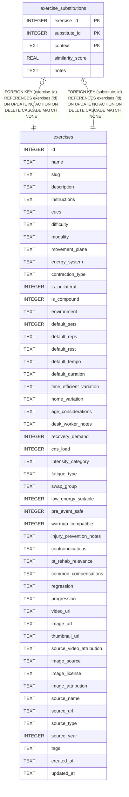

# exercise_substitutions

## Description

<details>
<summary><strong>Table Definition</strong></summary>

```sql
CREATE TABLE exercise_substitutions (
  exercise_id         INTEGER NOT NULL REFERENCES exercises(id) ON DELETE CASCADE,
  substitute_id       INTEGER NOT NULL REFERENCES exercises(id) ON DELETE CASCADE,
  context             TEXT NOT NULL CHECK (context IN (
                        'lower_intensity','lower_recovery','home_friendly',
                        'pre_event_safe','low_energy','equipment_swap',
                        'age_friendly','time_efficient')),
  similarity_score    REAL DEFAULT 0.5 CHECK (similarity_score BETWEEN 0.0 AND 1.0),
  notes               TEXT,
  PRIMARY KEY (exercise_id, substitute_id, context),
  CHECK (exercise_id != substitute_id)
)
```

</details>

## Columns

| Name             | Type    | Default | Nullable | Children | Parents                   | Comment |
| ---------------- | ------- | ------- | -------- | -------- | ------------------------- | ------- |
| exercise_id      | INTEGER |         | false    |          | [exercises](exercises.md) |         |
| substitute_id    | INTEGER |         | false    |          | [exercises](exercises.md) |         |
| context          | TEXT    |         | false    |          |                           |         |
| similarity_score | REAL    | 0.5     | true     |          |                           |         |
| notes            | TEXT    |         | true     |          |                           |         |

## Constraints

| Name                                      | Type        | Definition                                                                                                                                                |
| ----------------------------------------- | ----------- | --------------------------------------------------------------------------------------------------------------------------------------------------------- |
| exercise_id                               | PRIMARY KEY | PRIMARY KEY (exercise_id)                                                                                                                                 |
| substitute_id                             | PRIMARY KEY | PRIMARY KEY (substitute_id)                                                                                                                               |
| context                                   | PRIMARY KEY | PRIMARY KEY (context)                                                                                                                                     |
| - (Foreign key ID: 0)                     | FOREIGN KEY | FOREIGN KEY (substitute_id) REFERENCES exercises (id) ON UPDATE NO ACTION ON DELETE CASCADE MATCH NONE                                                    |
| - (Foreign key ID: 1)                     | FOREIGN KEY | FOREIGN KEY (exercise_id) REFERENCES exercises (id) ON UPDATE NO ACTION ON DELETE CASCADE MATCH NONE                                                      |
| sqlite_autoindex_exercise_substitutions_1 | PRIMARY KEY | PRIMARY KEY (exercise_id, substitute_id, context)                                                                                                         |
| -                                         | CHECK       | CHECK (context IN ( 'lower_intensity','lower_recovery','home_friendly', 'pre_event_safe','low_energy','equipment_swap', 'age_friendly','time_efficient')) |
| -                                         | CHECK       | CHECK (similarity_score BETWEEN 0.0 AND 1.0)                                                                                                              |
| -                                         | CHECK       | CHECK (exercise_id != substitute_id)                                                                                                                      |

## Indexes

| Name                                      | Definition                                                                              |
| ----------------------------------------- | --------------------------------------------------------------------------------------- |
| idx_sub_substitute                        | CREATE INDEX idx_sub_substitute                ON exercise_substitutions(substitute_id) |
| idx_sub_context                           | CREATE INDEX idx_sub_context                   ON exercise_substitutions(context)       |
| sqlite_autoindex_exercise_substitutions_1 | PRIMARY KEY (exercise_id, substitute_id, context)                                       |

## Relations



---

> Generated by [tbls](https://github.com/k1LoW/tbls)
