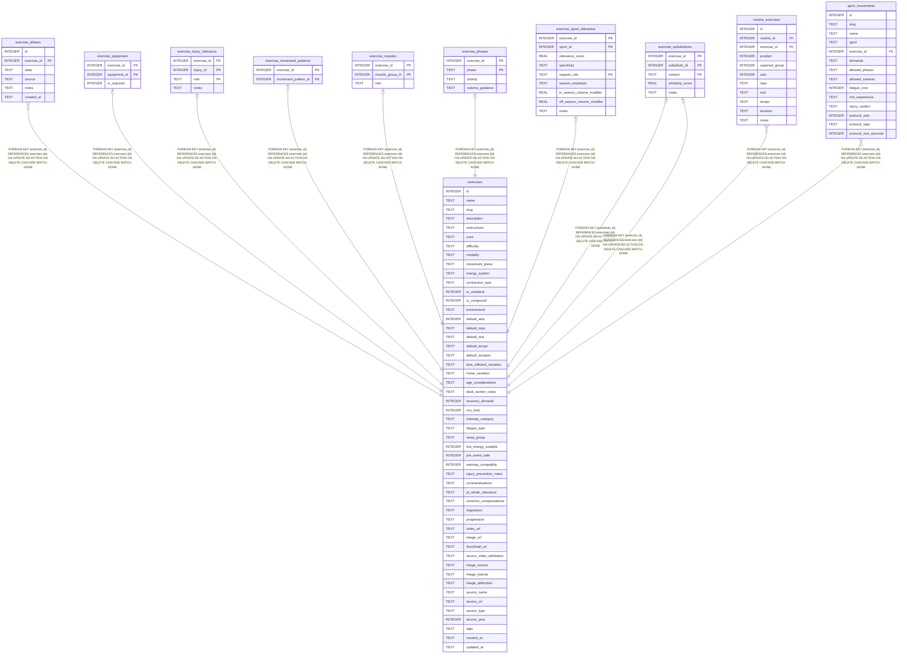

# exercises

## Description

The catalog. Ids are pinned in db/source/exercises.json and copied into user.db and UserDefaults, so an id change repoints saved routines and plans.

<details>
<summary><strong>Table Definition</strong></summary>

```sql
CREATE TABLE exercises (
  id                       INTEGER PRIMARY KEY,
  name                     TEXT NOT NULL,
  slug                     TEXT NOT NULL UNIQUE,
  description              TEXT NOT NULL,
  instructions             TEXT NOT NULL,
  cues                     TEXT,   -- JSON array
  difficulty               TEXT NOT NULL CHECK (difficulty IN ('beginner','intermediate','advanced','elite')),
  modality                 TEXT NOT NULL CHECK (modality IN (
                             'strength','power','endurance','flexibility','mobility',
                             'balance','coordination','agility','speed','plyometric',
                             'sport_drill','pt_rehab','prehab','breathing','recovery',
                             'warm_up','cool_down')),
  movement_plane           TEXT CHECK (movement_plane IN ('sagittal','frontal','transverse','multi_plane')),
  energy_system            TEXT CHECK (energy_system IN ('phosphagen','glycolytic','oxidative','mixed')),
  contraction_type         TEXT CHECK (contraction_type IN ('concentric','eccentric','isometric','plyometric','ballistic')),
  is_unilateral            INTEGER DEFAULT 0 CHECK (is_unilateral IN (0,1)),
  is_compound              INTEGER DEFAULT 1 CHECK (is_compound IN (0,1)),
  environment              TEXT DEFAULT 'gym' CHECK (environment IN ('gym','home','outdoor','sport_facility','travel','anywhere')),

  default_sets             INTEGER,
  default_reps             TEXT,
  default_rest             TEXT,
  default_tempo            TEXT,
  default_duration         TEXT,

  time_efficient_variation TEXT,
  home_variation           TEXT,
  age_considerations       TEXT,
  desk_worker_notes        TEXT,

  recovery_demand          INTEGER CHECK (recovery_demand BETWEEN 1 AND 10),
  cns_load                 INTEGER CHECK (cns_load BETWEEN 1 AND 10),
  intensity_category       TEXT CHECK (intensity_category IN ('low','moderate','high','max')),
  fatigue_type             TEXT,   -- JSON array
  swap_group               TEXT,
  low_energy_suitable      INTEGER DEFAULT 0 CHECK (low_energy_suitable IN (0,1)),
  pre_event_safe           INTEGER DEFAULT 1 CHECK (pre_event_safe IN (0,1)),
  warmup_compatible        INTEGER DEFAULT 0 CHECK (warmup_compatible IN (0,1)),

  injury_prevention_notes  TEXT,
  contraindications        TEXT,   -- JSON array
  pt_rehab_relevance       TEXT,
  common_compensations     TEXT,   -- JSON array
  regression               TEXT,
  progression              TEXT,

  video_url                TEXT,
  image_url                TEXT,
  thumbnail_url            TEXT,
  source_video_attribution TEXT,
  image_source             TEXT,   -- free-exercise-db | wger | wikimedia | youtube | other
  image_license            TEXT,   -- MIT | Unlicense | CC-BY-SA-4 | CC-BY-4 | PUBLIC-DOMAIN | CC0 | YouTube ToS
  image_attribution        TEXT,   -- human-readable attribution string

  source_name              TEXT,
  source_url               TEXT,
  source_type              TEXT CHECK (source_type IN ('peer_reviewed','clinical','governing_body','coaching','expert_consensus')),
  source_year              INTEGER,

  tags                     TEXT,   -- JSON array

  created_at               TEXT DEFAULT (datetime('now')),
  updated_at               TEXT DEFAULT (datetime('now'))
)
```

</details>

## Columns

| Name                     | Type    | Default         | Nullable | Children                                                                                                                                                                                                                                                                                                                                                                                                                                                                            | Comment |
| ------------------------ | ------- | --------------- | -------- | ----------------------------------------------------------------------------------------------------------------------------------------------------------------------------------------------------------------------------------------------------------------------------------------------------------------------------------------------------------------------------------------------------------------------------------------------------------------------------------- | ------- |
| id                       | INTEGER |                 | true     | [exercise_aliases](exercise_aliases.md) [exercise_equipment](exercise_equipment.md) [exercise_injury_relevance](exercise_injury_relevance.md) [exercise_movement_patterns](exercise_movement_patterns.md) [exercise_muscles](exercise_muscles.md) [exercise_phases](exercise_phases.md) [exercise_sport_relevance](exercise_sport_relevance.md) [exercise_substitutions](exercise_substitutions.md) [routine_exercises](routine_exercises.md) [sport_movements](sport_movements.md) |         |
| name                     | TEXT    |                 | false    |                                                                                                                                                                                                                                                                                                                                                                                                                                                                                     |         |
| slug                     | TEXT    |                 | false    |                                                                                                                                                                                                                                                                                                                                                                                                                                                                                     |         |
| description              | TEXT    |                 | false    |                                                                                                                                                                                                                                                                                                                                                                                                                                                                                     |         |
| instructions             | TEXT    |                 | false    |                                                                                                                                                                                                                                                                                                                                                                                                                                                                                     |         |
| cues                     | TEXT    |                 | true     |                                                                                                                                                                                                                                                                                                                                                                                                                                                                                     |         |
| difficulty               | TEXT    |                 | false    |                                                                                                                                                                                                                                                                                                                                                                                                                                                                                     |         |
| modality                 | TEXT    |                 | false    |                                                                                                                                                                                                                                                                                                                                                                                                                                                                                     |         |
| movement_plane           | TEXT    |                 | true     |                                                                                                                                                                                                                                                                                                                                                                                                                                                                                     |         |
| energy_system            | TEXT    |                 | true     |                                                                                                                                                                                                                                                                                                                                                                                                                                                                                     |         |
| contraction_type         | TEXT    |                 | true     |                                                                                                                                                                                                                                                                                                                                                                                                                                                                                     |         |
| is_unilateral            | INTEGER | 0               | true     |                                                                                                                                                                                                                                                                                                                                                                                                                                                                                     |         |
| is_compound              | INTEGER | 1               | true     |                                                                                                                                                                                                                                                                                                                                                                                                                                                                                     |         |
| environment              | TEXT    | 'gym'           | true     |                                                                                                                                                                                                                                                                                                                                                                                                                                                                                     |         |
| default_sets             | INTEGER |                 | true     |                                                                                                                                                                                                                                                                                                                                                                                                                                                                                     |         |
| default_reps             | TEXT    |                 | true     |                                                                                                                                                                                                                                                                                                                                                                                                                                                                                     |         |
| default_rest             | TEXT    |                 | true     |                                                                                                                                                                                                                                                                                                                                                                                                                                                                                     |         |
| default_tempo            | TEXT    |                 | true     |                                                                                                                                                                                                                                                                                                                                                                                                                                                                                     |         |
| default_duration         | TEXT    |                 | true     |                                                                                                                                                                                                                                                                                                                                                                                                                                                                                     |         |
| time_efficient_variation | TEXT    |                 | true     |                                                                                                                                                                                                                                                                                                                                                                                                                                                                                     |         |
| home_variation           | TEXT    |                 | true     |                                                                                                                                                                                                                                                                                                                                                                                                                                                                                     |         |
| age_considerations       | TEXT    |                 | true     |                                                                                                                                                                                                                                                                                                                                                                                                                                                                                     |         |
| desk_worker_notes        | TEXT    |                 | true     |                                                                                                                                                                                                                                                                                                                                                                                                                                                                                     |         |
| recovery_demand          | INTEGER |                 | true     |                                                                                                                                                                                                                                                                                                                                                                                                                                                                                     |         |
| cns_load                 | INTEGER |                 | true     |                                                                                                                                                                                                                                                                                                                                                                                                                                                                                     |         |
| intensity_category       | TEXT    |                 | true     |                                                                                                                                                                                                                                                                                                                                                                                                                                                                                     |         |
| fatigue_type             | TEXT    |                 | true     |                                                                                                                                                                                                                                                                                                                                                                                                                                                                                     |         |
| swap_group               | TEXT    |                 | true     |                                                                                                                                                                                                                                                                                                                                                                                                                                                                                     |         |
| low_energy_suitable      | INTEGER | 0               | true     |                                                                                                                                                                                                                                                                                                                                                                                                                                                                                     |         |
| pre_event_safe           | INTEGER | 1               | true     |                                                                                                                                                                                                                                                                                                                                                                                                                                                                                     |         |
| warmup_compatible        | INTEGER | 0               | true     |                                                                                                                                                                                                                                                                                                                                                                                                                                                                                     |         |
| injury_prevention_notes  | TEXT    |                 | true     |                                                                                                                                                                                                                                                                                                                                                                                                                                                                                     |         |
| contraindications        | TEXT    |                 | true     |                                                                                                                                                                                                                                                                                                                                                                                                                                                                                     |         |
| pt_rehab_relevance       | TEXT    |                 | true     |                                                                                                                                                                                                                                                                                                                                                                                                                                                                                     |         |
| common_compensations     | TEXT    |                 | true     |                                                                                                                                                                                                                                                                                                                                                                                                                                                                                     |         |
| regression               | TEXT    |                 | true     |                                                                                                                                                                                                                                                                                                                                                                                                                                                                                     |         |
| progression              | TEXT    |                 | true     |                                                                                                                                                                                                                                                                                                                                                                                                                                                                                     |         |
| video_url                | TEXT    |                 | true     |                                                                                                                                                                                                                                                                                                                                                                                                                                                                                     |         |
| image_url                | TEXT    |                 | true     |                                                                                                                                                                                                                                                                                                                                                                                                                                                                                     |         |
| thumbnail_url            | TEXT    |                 | true     |                                                                                                                                                                                                                                                                                                                                                                                                                                                                                     |         |
| source_video_attribution | TEXT    |                 | true     |                                                                                                                                                                                                                                                                                                                                                                                                                                                                                     |         |
| image_source             | TEXT    |                 | true     |                                                                                                                                                                                                                                                                                                                                                                                                                                                                                     |         |
| image_license            | TEXT    |                 | true     |                                                                                                                                                                                                                                                                                                                                                                                                                                                                                     |         |
| image_attribution        | TEXT    |                 | true     |                                                                                                                                                                                                                                                                                                                                                                                                                                                                                     |         |
| source_name              | TEXT    |                 | true     |                                                                                                                                                                                                                                                                                                                                                                                                                                                                                     |         |
| source_url               | TEXT    |                 | true     |                                                                                                                                                                                                                                                                                                                                                                                                                                                                                     |         |
| source_type              | TEXT    |                 | true     |                                                                                                                                                                                                                                                                                                                                                                                                                                                                                     |         |
| source_year              | INTEGER |                 | true     |                                                                                                                                                                                                                                                                                                                                                                                                                                                                                     |         |
| tags                     | TEXT    |                 | true     |                                                                                                                                                                                                                                                                                                                                                                                                                                                                                     |         |
| created_at               | TEXT    | datetime('now') | true     |                                                                                                                                                                                                                                                                                                                                                                                                                                                                                     |         |
| updated_at               | TEXT    | datetime('now') | true     |                                                                                                                                                                                                                                                                                                                                                                                                                                                                                     |         |

## Constraints

| Name                         | Type        | Definition                                                                                                                                                                                                               |
| ---------------------------- | ----------- | ------------------------------------------------------------------------------------------------------------------------------------------------------------------------------------------------------------------------ |
| id                           | PRIMARY KEY | PRIMARY KEY (id)                                                                                                                                                                                                         |
| sqlite_autoindex_exercises_1 | UNIQUE      | UNIQUE (slug)                                                                                                                                                                                                            |
| -                            | CHECK       | CHECK (difficulty IN ('beginner','intermediate','advanced','elite'))                                                                                                                                                     |
| -                            | CHECK       | CHECK (modality IN ( 'strength','power','endurance','flexibility','mobility', 'balance','coordination','agility','speed','plyometric', 'sport_drill','pt_rehab','prehab','breathing','recovery', 'warm_up','cool_down')) |
| -                            | CHECK       | CHECK (movement_plane IN ('sagittal','frontal','transverse','multi_plane'))                                                                                                                                              |
| -                            | CHECK       | CHECK (energy_system IN ('phosphagen','glycolytic','oxidative','mixed'))                                                                                                                                                 |
| -                            | CHECK       | CHECK (contraction_type IN ('concentric','eccentric','isometric','plyometric','ballistic'))                                                                                                                              |
| -                            | CHECK       | CHECK (is_unilateral IN (0,1))                                                                                                                                                                                           |
| -                            | CHECK       | CHECK (is_compound IN (0,1))                                                                                                                                                                                             |
| -                            | CHECK       | CHECK (environment IN ('gym','home','outdoor','sport_facility','travel','anywhere'))                                                                                                                                     |
| -                            | CHECK       | CHECK (recovery_demand BETWEEN 1 AND 10)                                                                                                                                                                                 |
| -                            | CHECK       | CHECK (cns_load BETWEEN 1 AND 10)                                                                                                                                                                                        |
| -                            | CHECK       | CHECK (intensity_category IN ('low','moderate','high','max'))                                                                                                                                                            |
| -                            | CHECK       | CHECK (low_energy_suitable IN (0,1))                                                                                                                                                                                     |
| -                            | CHECK       | CHECK (pre_event_safe IN (0,1))                                                                                                                                                                                          |
| -                            | CHECK       | CHECK (warmup_compatible IN (0,1))                                                                                                                                                                                       |
| -                            | CHECK       | CHECK (source_type IN ('peer_reviewed','clinical','governing_body','coaching','expert_consensus'))                                                                                                                       |

## Indexes

| Name                         | Definition                                                                       |
| ---------------------------- | -------------------------------------------------------------------------------- |
| idx_exercises_swap_group     | CREATE INDEX idx_exercises_swap_group          ON exercises(swap_group)          |
| idx_exercises_pre_event_safe | CREATE INDEX idx_exercises_pre_event_safe      ON exercises(pre_event_safe)      |
| idx_exercises_modality       | CREATE INDEX idx_exercises_modality            ON exercises(modality)            |
| idx_exercises_low_energy     | CREATE INDEX idx_exercises_low_energy          ON exercises(low_energy_suitable) |
| idx_exercises_environment    | CREATE INDEX idx_exercises_environment         ON exercises(environment)         |
| idx_exercises_difficulty     | CREATE INDEX idx_exercises_difficulty          ON exercises(difficulty)          |
| sqlite_autoindex_exercises_1 | UNIQUE (slug)                                                                    |

## Relations



---

> Generated by [tbls](https://github.com/k1LoW/tbls)
