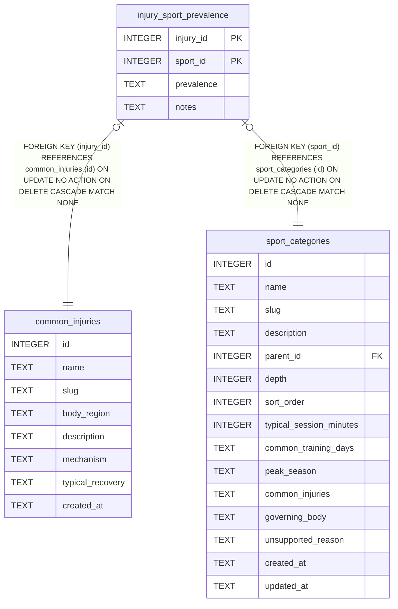

# injury_sport_prevalence

## Description

<details>
<summary><strong>Table Definition</strong></summary>

```sql
CREATE TABLE injury_sport_prevalence (
  injury_id       INTEGER NOT NULL REFERENCES common_injuries(id) ON DELETE CASCADE,
  sport_id        INTEGER NOT NULL REFERENCES sport_categories(id) ON DELETE CASCADE,
  prevalence      TEXT CHECK (prevalence IN ('common','occasional','rare')),
  notes           TEXT,
  PRIMARY KEY (injury_id, sport_id)
)
```

</details>

## Columns

| Name       | Type    | Default | Nullable | Children | Parents                                 | Comment |
| ---------- | ------- | ------- | -------- | -------- | --------------------------------------- | ------- |
| injury_id  | INTEGER |         | false    |          | [common_injuries](common_injuries.md)   |         |
| sport_id   | INTEGER |         | false    |          | [sport_categories](sport_categories.md) |         |
| prevalence | TEXT    |         | true     |          |                                         |         |
| notes      | TEXT    |         | true     |          |                                         |         |

## Constraints

| Name                                       | Type        | Definition                                                                                               |
| ------------------------------------------ | ----------- | -------------------------------------------------------------------------------------------------------- |
| injury_id                                  | PRIMARY KEY | PRIMARY KEY (injury_id)                                                                                  |
| sport_id                                   | PRIMARY KEY | PRIMARY KEY (sport_id)                                                                                   |
| - (Foreign key ID: 0)                      | FOREIGN KEY | FOREIGN KEY (sport_id) REFERENCES sport_categories (id) ON UPDATE NO ACTION ON DELETE CASCADE MATCH NONE |
| - (Foreign key ID: 1)                      | FOREIGN KEY | FOREIGN KEY (injury_id) REFERENCES common_injuries (id) ON UPDATE NO ACTION ON DELETE CASCADE MATCH NONE |
| sqlite_autoindex_injury_sport_prevalence_1 | PRIMARY KEY | PRIMARY KEY (injury_id, sport_id)                                                                        |
| -                                          | CHECK       | CHECK (prevalence IN ('common','occasional','rare'))                                                     |

## Indexes

| Name                                       | Definition                                                                          |
| ------------------------------------------ | ----------------------------------------------------------------------------------- |
| idx_injury_prev_sport                      | CREATE INDEX idx_injury_prev_sport             ON injury_sport_prevalence(sport_id) |
| sqlite_autoindex_injury_sport_prevalence_1 | PRIMARY KEY (injury_id, sport_id)                                                   |

## Relations



---

> Generated by [tbls](https://github.com/k1LoW/tbls)
