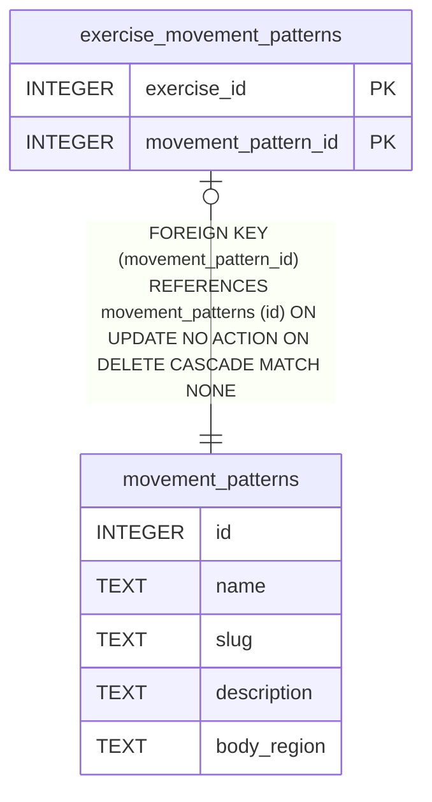

# movement_patterns

## Description

<details>
<summary><strong>Table Definition</strong></summary>

```sql
CREATE TABLE movement_patterns (
  id                       INTEGER PRIMARY KEY,
  name                     TEXT NOT NULL UNIQUE,
  slug                     TEXT NOT NULL UNIQUE,
  description              TEXT,
  body_region              TEXT
)
```

</details>

## Columns

| Name        | Type    | Default | Nullable | Children                                                    | Comment |
| ----------- | ------- | ------- | -------- | ----------------------------------------------------------- | ------- |
| id          | INTEGER |         | true     | [exercise_movement_patterns](exercise_movement_patterns.md) |         |
| name        | TEXT    |         | false    |                                                             |         |
| slug        | TEXT    |         | false    |                                                             |         |
| description | TEXT    |         | true     |                                                             |         |
| body_region | TEXT    |         | true     |                                                             |         |

## Constraints

| Name                                 | Type        | Definition       |
| ------------------------------------ | ----------- | ---------------- |
| id                                   | PRIMARY KEY | PRIMARY KEY (id) |
| sqlite_autoindex_movement_patterns_2 | UNIQUE      | UNIQUE (slug)    |
| sqlite_autoindex_movement_patterns_1 | UNIQUE      | UNIQUE (name)    |

## Indexes

| Name                                 | Definition    |
| ------------------------------------ | ------------- |
| sqlite_autoindex_movement_patterns_2 | UNIQUE (slug) |
| sqlite_autoindex_movement_patterns_1 | UNIQUE (name) |

## Relations



---

> Generated by [tbls](https://github.com/k1LoW/tbls)
