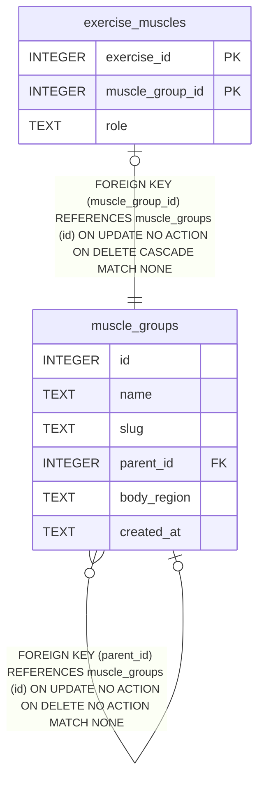

# muscle_groups

## Description

<details>
<summary><strong>Table Definition</strong></summary>

```sql
CREATE TABLE muscle_groups (
  id                       INTEGER PRIMARY KEY,
  name                     TEXT NOT NULL UNIQUE,
  slug                     TEXT NOT NULL UNIQUE,
  parent_id                INTEGER REFERENCES muscle_groups(id),
  body_region              TEXT CHECK (body_region IN ('upper_body','lower_body','core','full_body','neck')),
  created_at               TEXT DEFAULT (datetime('now'))
)
```

</details>

## Columns

| Name        | Type    | Default         | Nullable | Children                                                                  | Parents                           | Comment |
| ----------- | ------- | --------------- | -------- | ------------------------------------------------------------------------- | --------------------------------- | ------- |
| id          | INTEGER |                 | true     | [exercise_muscles](exercise_muscles.md) [muscle_groups](muscle_groups.md) |                                   |         |
| name        | TEXT    |                 | false    |                                                                           |                                   |         |
| slug        | TEXT    |                 | false    |                                                                           |                                   |         |
| parent_id   | INTEGER |                 | true     |                                                                           | [muscle_groups](muscle_groups.md) |         |
| body_region | TEXT    |                 | true     |                                                                           |                                   |         |
| created_at  | TEXT    | datetime('now') | true     |                                                                           |                                   |         |

## Constraints

| Name                             | Type        | Definition                                                                                               |
| -------------------------------- | ----------- | -------------------------------------------------------------------------------------------------------- |
| id                               | PRIMARY KEY | PRIMARY KEY (id)                                                                                         |
| - (Foreign key ID: 0)            | FOREIGN KEY | FOREIGN KEY (parent_id) REFERENCES muscle_groups (id) ON UPDATE NO ACTION ON DELETE NO ACTION MATCH NONE |
| sqlite_autoindex_muscle_groups_2 | UNIQUE      | UNIQUE (slug)                                                                                            |
| sqlite_autoindex_muscle_groups_1 | UNIQUE      | UNIQUE (name)                                                                                            |
| -                                | CHECK       | CHECK (body_region IN ('upper_body','lower_body','core','full_body','neck'))                             |

## Indexes

| Name                             | Definition                                                                 |
| -------------------------------- | -------------------------------------------------------------------------- |
| idx_muscle_parent                | CREATE INDEX idx_muscle_parent                 ON muscle_groups(parent_id) |
| sqlite_autoindex_muscle_groups_2 | UNIQUE (slug)                                                              |
| sqlite_autoindex_muscle_groups_1 | UNIQUE (name)                                                              |

## Relations



---

> Generated by [tbls](https://github.com/k1LoW/tbls)
