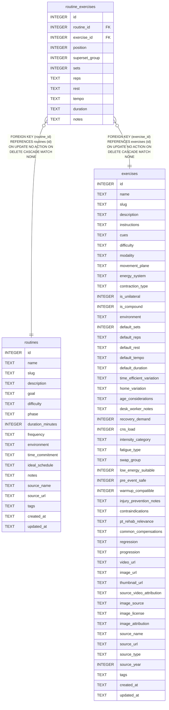

# routine_exercises

## Description

<details>
<summary><strong>Table Definition</strong></summary>

```sql
CREATE TABLE routine_exercises (
  id                       INTEGER PRIMARY KEY AUTOINCREMENT,
  routine_id               INTEGER NOT NULL REFERENCES routines(id) ON DELETE CASCADE,
  exercise_id              INTEGER NOT NULL REFERENCES exercises(id) ON DELETE CASCADE,
  position                 INTEGER NOT NULL,
  superset_group           INTEGER,
  sets                     INTEGER,
  reps                     TEXT,
  rest                     TEXT,
  tempo                    TEXT,
  duration                 TEXT,
  notes                    TEXT,
  UNIQUE (routine_id, position)
)
```

</details>

## Columns

| Name           | Type    | Default | Nullable | Children | Parents                   | Comment |
| -------------- | ------- | ------- | -------- | -------- | ------------------------- | ------- |
| id             | INTEGER |         | true     |          |                           |         |
| routine_id     | INTEGER |         | false    |          | [routines](routines.md)   |         |
| exercise_id    | INTEGER |         | false    |          | [exercises](exercises.md) |         |
| position       | INTEGER |         | false    |          |                           |         |
| superset_group | INTEGER |         | true     |          |                           |         |
| sets           | INTEGER |         | true     |          |                           |         |
| reps           | TEXT    |         | true     |          |                           |         |
| rest           | TEXT    |         | true     |          |                           |         |
| tempo          | TEXT    |         | true     |          |                           |         |
| duration       | TEXT    |         | true     |          |                           |         |
| notes          | TEXT    |         | true     |          |                           |         |

## Constraints

| Name                                 | Type        | Definition                                                                                           |
| ------------------------------------ | ----------- | ---------------------------------------------------------------------------------------------------- |
| id                                   | PRIMARY KEY | PRIMARY KEY (id)                                                                                     |
| - (Foreign key ID: 0)                | FOREIGN KEY | FOREIGN KEY (exercise_id) REFERENCES exercises (id) ON UPDATE NO ACTION ON DELETE CASCADE MATCH NONE |
| - (Foreign key ID: 1)                | FOREIGN KEY | FOREIGN KEY (routine_id) REFERENCES routines (id) ON UPDATE NO ACTION ON DELETE CASCADE MATCH NONE   |
| sqlite_autoindex_routine_exercises_1 | UNIQUE      | UNIQUE (routine_id, position)                                                                        |

## Indexes

| Name                                 | Definition                                                                      |
| ------------------------------------ | ------------------------------------------------------------------------------- |
| idx_routine_ex_routine               | CREATE INDEX idx_routine_ex_routine            ON routine_exercises(routine_id) |
| sqlite_autoindex_routine_exercises_1 | UNIQUE (routine_id, position)                                                   |

## Relations



---

> Generated by [tbls](https://github.com/k1LoW/tbls)
