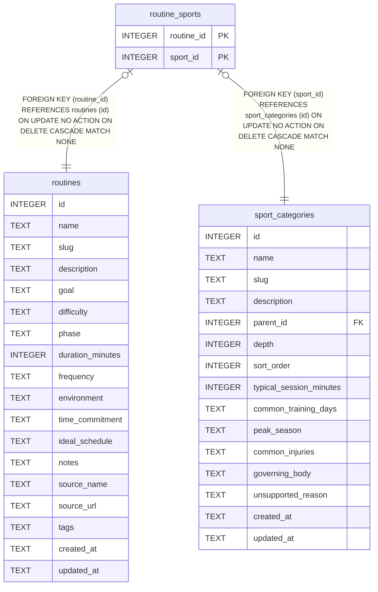

# routine_sports

## Description

<details>
<summary><strong>Table Definition</strong></summary>

```sql
CREATE TABLE routine_sports (
  routine_id               INTEGER NOT NULL REFERENCES routines(id) ON DELETE CASCADE,
  sport_id                 INTEGER NOT NULL REFERENCES sport_categories(id) ON DELETE CASCADE,
  PRIMARY KEY (routine_id, sport_id)
)
```

</details>

## Columns

| Name       | Type    | Default | Nullable | Children | Parents                                 | Comment |
| ---------- | ------- | ------- | -------- | -------- | --------------------------------------- | ------- |
| routine_id | INTEGER |         | false    |          | [routines](routines.md)                 |         |
| sport_id   | INTEGER |         | false    |          | [sport_categories](sport_categories.md) |         |

## Constraints

| Name                              | Type        | Definition                                                                                               |
| --------------------------------- | ----------- | -------------------------------------------------------------------------------------------------------- |
| routine_id                        | PRIMARY KEY | PRIMARY KEY (routine_id)                                                                                 |
| sport_id                          | PRIMARY KEY | PRIMARY KEY (sport_id)                                                                                   |
| - (Foreign key ID: 0)             | FOREIGN KEY | FOREIGN KEY (sport_id) REFERENCES sport_categories (id) ON UPDATE NO ACTION ON DELETE CASCADE MATCH NONE |
| - (Foreign key ID: 1)             | FOREIGN KEY | FOREIGN KEY (routine_id) REFERENCES routines (id) ON UPDATE NO ACTION ON DELETE CASCADE MATCH NONE       |
| sqlite_autoindex_routine_sports_1 | PRIMARY KEY | PRIMARY KEY (routine_id, sport_id)                                                                       |

## Indexes

| Name                              | Definition                                                                 |
| --------------------------------- | -------------------------------------------------------------------------- |
| idx_routine_sports_sport          | CREATE INDEX idx_routine_sports_sport          ON routine_sports(sport_id) |
| sqlite_autoindex_routine_sports_1 | PRIMARY KEY (routine_id, sport_id)                                         |

## Relations



---

> Generated by [tbls](https://github.com/k1LoW/tbls)
