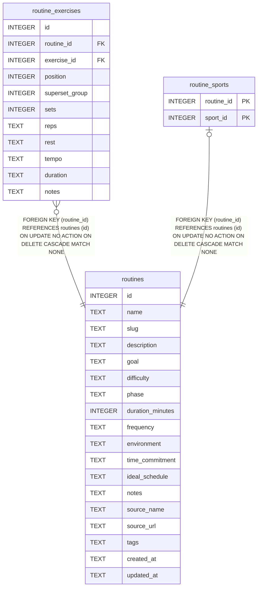

# routines

## Description

<details>
<summary><strong>Table Definition</strong></summary>

```sql
CREATE TABLE routines (
  id                       INTEGER PRIMARY KEY,
  name                     TEXT NOT NULL,
  slug                     TEXT NOT NULL UNIQUE,
  description              TEXT,
  goal                     TEXT,
  difficulty               TEXT CHECK (difficulty IN ('beginner','intermediate','advanced','elite')),
  phase                    TEXT CHECK (phase IN ('off_season','base','build','peak','race','recovery','maintenance')),
  duration_minutes         INTEGER,
  frequency                TEXT,
  environment              TEXT CHECK (environment IN ('gym','home','outdoor','sport_facility','travel','anywhere')),
  time_commitment          TEXT,
  ideal_schedule           TEXT,
  notes                    TEXT,
  source_name              TEXT,
  source_url               TEXT,
  tags                     TEXT,   -- JSON array
  created_at               TEXT DEFAULT (datetime('now')),
  updated_at               TEXT DEFAULT (datetime('now'))
)
```

</details>

## Columns

| Name             | Type    | Default         | Nullable | Children                                                                      | Comment |
| ---------------- | ------- | --------------- | -------- | ----------------------------------------------------------------------------- | ------- |
| id               | INTEGER |                 | true     | [routine_exercises](routine_exercises.md) [routine_sports](routine_sports.md) |         |
| name             | TEXT    |                 | false    |                                                                               |         |
| slug             | TEXT    |                 | false    |                                                                               |         |
| description      | TEXT    |                 | true     |                                                                               |         |
| goal             | TEXT    |                 | true     |                                                                               |         |
| difficulty       | TEXT    |                 | true     |                                                                               |         |
| phase            | TEXT    |                 | true     |                                                                               |         |
| duration_minutes | INTEGER |                 | true     |                                                                               |         |
| frequency        | TEXT    |                 | true     |                                                                               |         |
| environment      | TEXT    |                 | true     |                                                                               |         |
| time_commitment  | TEXT    |                 | true     |                                                                               |         |
| ideal_schedule   | TEXT    |                 | true     |                                                                               |         |
| notes            | TEXT    |                 | true     |                                                                               |         |
| source_name      | TEXT    |                 | true     |                                                                               |         |
| source_url       | TEXT    |                 | true     |                                                                               |         |
| tags             | TEXT    |                 | true     |                                                                               |         |
| created_at       | TEXT    | datetime('now') | true     |                                                                               |         |
| updated_at       | TEXT    | datetime('now') | true     |                                                                               |         |

## Constraints

| Name                        | Type        | Definition                                                                            |
| --------------------------- | ----------- | ------------------------------------------------------------------------------------- |
| id                          | PRIMARY KEY | PRIMARY KEY (id)                                                                      |
| sqlite_autoindex_routines_1 | UNIQUE      | UNIQUE (slug)                                                                         |
| -                           | CHECK       | CHECK (difficulty IN ('beginner','intermediate','advanced','elite'))                  |
| -                           | CHECK       | CHECK (phase IN ('off_season','base','build','peak','race','recovery','maintenance')) |
| -                           | CHECK       | CHECK (environment IN ('gym','home','outdoor','sport_facility','travel','anywhere'))  |

## Indexes

| Name                        | Definition    |
| --------------------------- | ------------- |
| sqlite_autoindex_routines_1 | UNIQUE (slug) |

## Relations



---

> Generated by [tbls](https://github.com/k1LoW/tbls)
