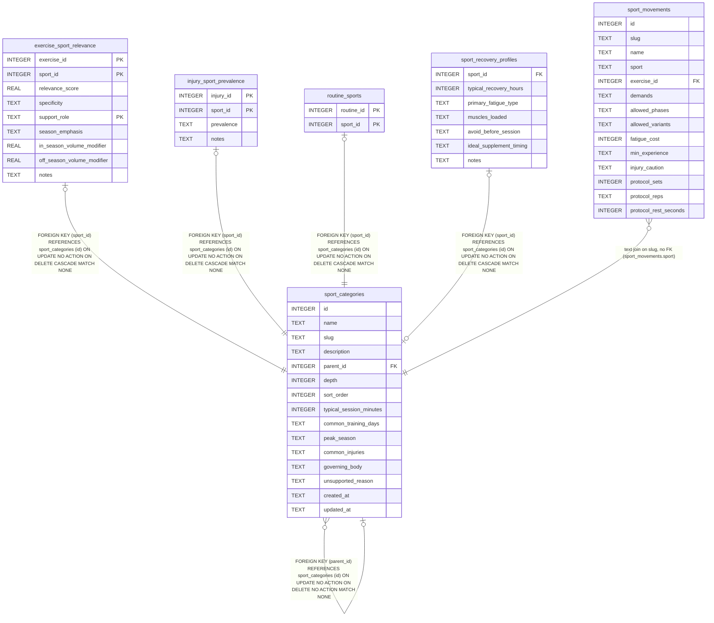

# sport_categories

## Description

<details>
<summary><strong>Table Definition</strong></summary>

```sql
CREATE TABLE sport_categories (
  id                       INTEGER PRIMARY KEY,
  name                     TEXT NOT NULL UNIQUE,
  slug                     TEXT NOT NULL UNIQUE,
  description              TEXT,
  parent_id                INTEGER REFERENCES sport_categories(id),
  depth                    INTEGER NOT NULL DEFAULT 0,
  sort_order               INTEGER DEFAULT 0,
  typical_session_minutes  INTEGER,
  common_training_days     TEXT,
  peak_season              TEXT,
  common_injuries          TEXT,   -- JSON array of strings
  governing_body           TEXT,
  -- Phase 1.2 sport-coverage floor. When a depth<=1 sport is intentionally
  -- out of scope for training-plan generation, populate this with a short
  -- rationale (e.g. "No general-strength transfer; niche audience"). NULL =
  -- in scope. See scripts/validate_coverage.sql.
  unsupported_reason       TEXT,
  created_at               TEXT DEFAULT (datetime('now')),
  updated_at               TEXT DEFAULT (datetime('now'))
)
```

</details>

## Columns

| Name                    | Type    | Default         | Nullable | Children                                                                                                                                                                                                                                        | Parents                                 | Comment                                  |
| ----------------------- | ------- | --------------- | -------- | ----------------------------------------------------------------------------------------------------------------------------------------------------------------------------------------------------------------------------------------------- | --------------------------------------- | ---------------------------------------- |
| id                      | INTEGER |                 | true     | [exercise_sport_relevance](exercise_sport_relevance.md) [injury_sport_prevalence](injury_sport_prevalence.md) [routine_sports](routine_sports.md) [sport_categories](sport_categories.md) [sport_recovery_profiles](sport_recovery_profiles.md) |                                         |                                          |
| name                    | TEXT    |                 | false    |                                                                                                                                                                                                                                                 |                                         |                                          |
| slug                    | TEXT    |                 | false    | [sport_movements](sport_movements.md)                                                                                                                                                                                                           |                                         |                                          |
| description             | TEXT    |                 | true     |                                                                                                                                                                                                                                                 |                                         |                                          |
| parent_id               | INTEGER |                 | true     |                                                                                                                                                                                                                                                 | [sport_categories](sport_categories.md) |                                          |
| depth                   | INTEGER | 0               | false    |                                                                                                                                                                                                                                                 |                                         |                                          |
| sort_order              | INTEGER | 0               | true     |                                                                                                                                                                                                                                                 |                                         |                                          |
| typical_session_minutes | INTEGER |                 | true     |                                                                                                                                                                                                                                                 |                                         |                                          |
| common_training_days    | TEXT    |                 | true     |                                                                                                                                                                                                                                                 |                                         |                                          |
| peak_season             | TEXT    |                 | true     |                                                                                                                                                                                                                                                 |                                         |                                          |
| common_injuries         | TEXT    |                 | true     |                                                                                                                                                                                                                                                 |                                         |                                          |
| governing_body          | TEXT    |                 | true     |                                                                                                                                                                                                                                                 |                                         |                                          |
| unsupported_reason      | TEXT    |                 | true     |                                                                                                                                                                                                                                                 |                                         | NULL means in scope for plan generation. |
| created_at              | TEXT    | datetime('now') | true     |                                                                                                                                                                                                                                                 |                                         |                                          |
| updated_at              | TEXT    | datetime('now') | true     |                                                                                                                                                                                                                                                 |                                         |                                          |

## Constraints

| Name                                | Type        | Definition                                                                                                  |
| ----------------------------------- | ----------- | ----------------------------------------------------------------------------------------------------------- |
| id                                  | PRIMARY KEY | PRIMARY KEY (id)                                                                                            |
| - (Foreign key ID: 0)               | FOREIGN KEY | FOREIGN KEY (parent_id) REFERENCES sport_categories (id) ON UPDATE NO ACTION ON DELETE NO ACTION MATCH NONE |
| sqlite_autoindex_sport_categories_2 | UNIQUE      | UNIQUE (slug)                                                                                               |
| sqlite_autoindex_sport_categories_1 | UNIQUE      | UNIQUE (name)                                                                                               |

## Indexes

| Name                                | Definition                                                                    |
| ----------------------------------- | ----------------------------------------------------------------------------- |
| idx_sport_parent                    | CREATE INDEX idx_sport_parent                  ON sport_categories(parent_id) |
| idx_sport_depth                     | CREATE INDEX idx_sport_depth                   ON sport_categories(depth)     |
| sqlite_autoindex_sport_categories_2 | UNIQUE (slug)                                                                 |
| sqlite_autoindex_sport_categories_1 | UNIQUE (name)                                                                 |

## Relations



---

> Generated by [tbls](https://github.com/k1LoW/tbls)
