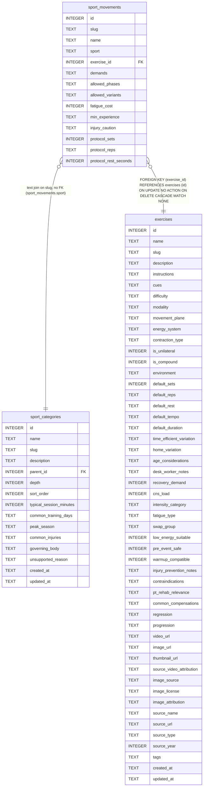

# sport_movements

## Description

Season-aware movement pool. `sport` is a sport_categories slug with no FK.

<details>
<summary><strong>Table Definition</strong></summary>

```sql
CREATE TABLE sport_movements (
  id                INTEGER PRIMARY KEY,
  slug              TEXT NOT NULL,
  name              TEXT NOT NULL,
  sport             TEXT NOT NULL,            -- sport_categories.slug (e.g. alpine-skiing)
  exercise_id       INTEGER NOT NULL REFERENCES exercises(id) ON DELETE CASCADE,
  demands           TEXT NOT NULL,            -- JSON array of Demand rawValues, primary first
  allowed_phases    TEXT NOT NULL,            -- JSON array of SeasonPhase rawValues
  allowed_variants  TEXT,                     -- JSON array of SportVariant rawValues; NULL = all
  fatigue_cost      INTEGER NOT NULL DEFAULT 2 CHECK (fatigue_cost BETWEEN 1 AND 5),
  min_experience    TEXT,                     -- novice|intermediate|advanced; NULL = no gate
  injury_caution    TEXT,
  -- Optional per-movement prescription (R3-9). The engine prescribes by DEMAND
  -- (DemandScheme), which is right for a generic squat and wrong for a movement
  -- that carries a cited protocol: the no-hang finger pull is a 3 s overcoming
  -- isometric and was being served as 5x8s holds. When these are set the
  -- scheme's sets/reps/rest yield to them; RPE and tempo still come from the scheme.
  protocol_sets         INTEGER CHECK (protocol_sets BETWEEN 1 AND 10),
  protocol_reps         TEXT,
  protocol_rest_seconds INTEGER CHECK (protocol_rest_seconds BETWEEN 0 AND 600)
)
```

</details>

## Columns

| Name                  | Type    | Default | Nullable | Children | Parents                                 | Comment |
| --------------------- | ------- | ------- | -------- | -------- | --------------------------------------- | ------- |
| id                    | INTEGER |         | true     |          |                                         |         |
| slug                  | TEXT    |         | false    |          |                                         |         |
| name                  | TEXT    |         | false    |          |                                         |         |
| sport                 | TEXT    |         | false    |          | [sport_categories](sport_categories.md) |         |
| exercise_id           | INTEGER |         | false    |          | [exercises](exercises.md)               |         |
| demands               | TEXT    |         | false    |          |                                         |         |
| allowed_phases        | TEXT    |         | false    |          |                                         |         |
| allowed_variants      | TEXT    |         | true     |          |                                         |         |
| fatigue_cost          | INTEGER | 2       | false    |          |                                         |         |
| min_experience        | TEXT    |         | true     |          |                                         |         |
| injury_caution        | TEXT    |         | true     |          |                                         |         |
| protocol_sets         | INTEGER |         | true     |          |                                         |         |
| protocol_reps         | TEXT    |         | true     |          |                                         |         |
| protocol_rest_seconds | INTEGER |         | true     |          |                                         |         |

## Constraints

| Name                  | Type        | Definition                                                                                           |
| --------------------- | ----------- | ---------------------------------------------------------------------------------------------------- |
| id                    | PRIMARY KEY | PRIMARY KEY (id)                                                                                     |
| - (Foreign key ID: 0) | FOREIGN KEY | FOREIGN KEY (exercise_id) REFERENCES exercises (id) ON UPDATE NO ACTION ON DELETE CASCADE MATCH NONE |
| -                     | CHECK       | CHECK (fatigue_cost BETWEEN 1 AND 5)                                                                 |
| -                     | CHECK       | CHECK (protocol_sets BETWEEN 1 AND 10)                                                               |
| -                     | CHECK       | CHECK (protocol_rest_seconds BETWEEN 0 AND 600)                                                      |

## Indexes

| Name                         | Definition                                                                     |
| ---------------------------- | ------------------------------------------------------------------------------ |
| idx_sport_movements_exercise | CREATE INDEX idx_sport_movements_exercise      ON sport_movements(exercise_id) |
| idx_sport_movements_sport    | CREATE INDEX idx_sport_movements_sport         ON sport_movements(sport)       |

## Relations



---

> Generated by [tbls](https://github.com/k1LoW/tbls)
