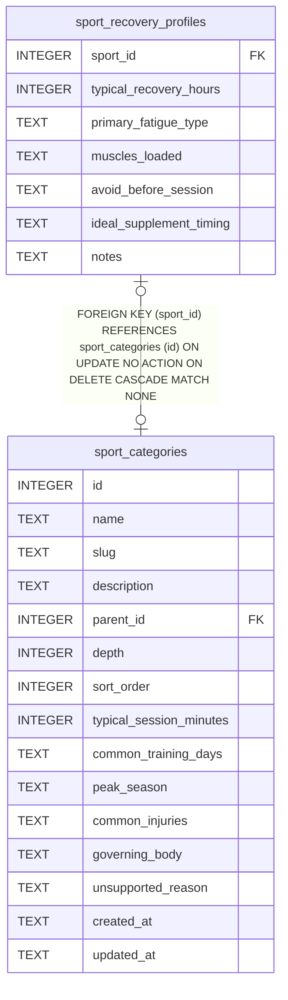

# sport_recovery_profiles

## Description

<details>
<summary><strong>Table Definition</strong></summary>

```sql
CREATE TABLE sport_recovery_profiles (
  sport_id                 INTEGER PRIMARY KEY REFERENCES sport_categories(id) ON DELETE CASCADE,
  typical_recovery_hours   INTEGER,
  primary_fatigue_type     TEXT,   -- JSON array
  muscles_loaded           TEXT,   -- JSON array
  avoid_before_session     TEXT,   -- JSON array
  ideal_supplement_timing  TEXT,
  notes                    TEXT
)
```

</details>

## Columns

| Name                    | Type    | Default | Nullable | Children | Parents                                 | Comment |
| ----------------------- | ------- | ------- | -------- | -------- | --------------------------------------- | ------- |
| sport_id                | INTEGER |         | true     |          | [sport_categories](sport_categories.md) |         |
| typical_recovery_hours  | INTEGER |         | true     |          |                                         |         |
| primary_fatigue_type    | TEXT    |         | true     |          |                                         |         |
| muscles_loaded          | TEXT    |         | true     |          |                                         |         |
| avoid_before_session    | TEXT    |         | true     |          |                                         |         |
| ideal_supplement_timing | TEXT    |         | true     |          |                                         |         |
| notes                   | TEXT    |         | true     |          |                                         |         |

## Constraints

| Name                  | Type        | Definition                                                                                               |
| --------------------- | ----------- | -------------------------------------------------------------------------------------------------------- |
| sport_id              | PRIMARY KEY | PRIMARY KEY (sport_id)                                                                                   |
| - (Foreign key ID: 0) | FOREIGN KEY | FOREIGN KEY (sport_id) REFERENCES sport_categories (id) ON UPDATE NO ACTION ON DELETE CASCADE MATCH NONE |

## Relations



---

> Generated by [tbls](https://github.com/k1LoW/tbls)
