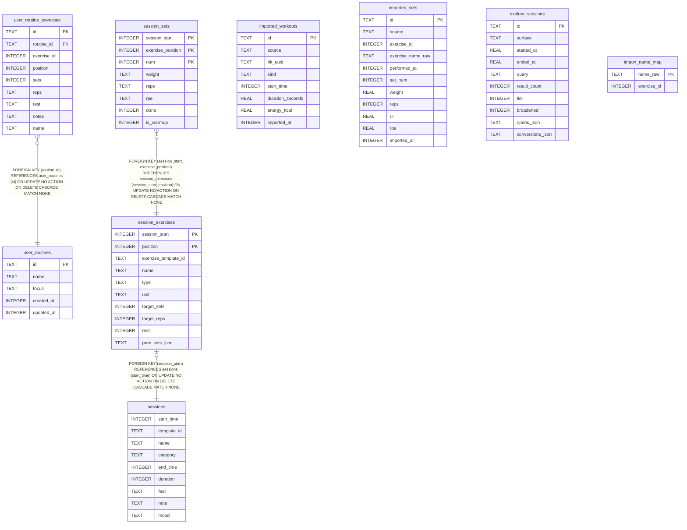

# user.db

## Description

On-device workout history (Documents/user.db). Schema from the migrations in PhaseTraining/Data/UserDatabase.swift, versioned by PRAGMA user_version.

## Tables

| Name                                                | Columns | Comment                                                                                                                                                                                      | Type  |
| --------------------------------------------------- | ------- | -------------------------------------------------------------------------------------------------------------------------------------------------------------------------------------------- | ----- |
| [user_routines](user_routines.md)                   | 5       |                                                                                                                                                                                              | table |
| [user_routine_exercises](user_routine_exercises.md) | 9       |                                                                                                                                                                                              | table |
| [sessions](sessions.md)                             | 9       | One saved native workout. start_time (epoch seconds) is the session id, referenced from UserDefaults by DayOutcome.sessionId, WeekPlanSnapshot.actualSessionIDs and FeedbackEntry.sessionId. | table |
| [session_exercises](session_exercises.md)           | 10      |                                                                                                                                                                                              | table |
| [session_sets](session_sets.md)                     | 8       |                                                                                                                                                                                              | table |
| [imported_workouts](imported_workouts.md)           | 8       | HealthKit or CSV workouts, keyed by the source's own UUID so re-import is idempotent. Unioned with sessions in GeneratorContext.                                                             | table |
| [imported_sets](imported_sets.md)                   | 11      | Set-level CSV history. Attached to imported_workouts by performed_at proximity in Swift, not by FK.                                                                                          | table |
| [explore_sessions](explore_sessions.md)             | 10      | One row per visit to a browse surface (ExploreSession.swift). Not included in the backup envelope.                                                                                           | table |
| [import_name_map](import_name_map.md)               | 2       |                                                                                                                                                                                              | table |

## Relations

---

> Generated by [tbls](https://github.com/k1LoW/tbls)
