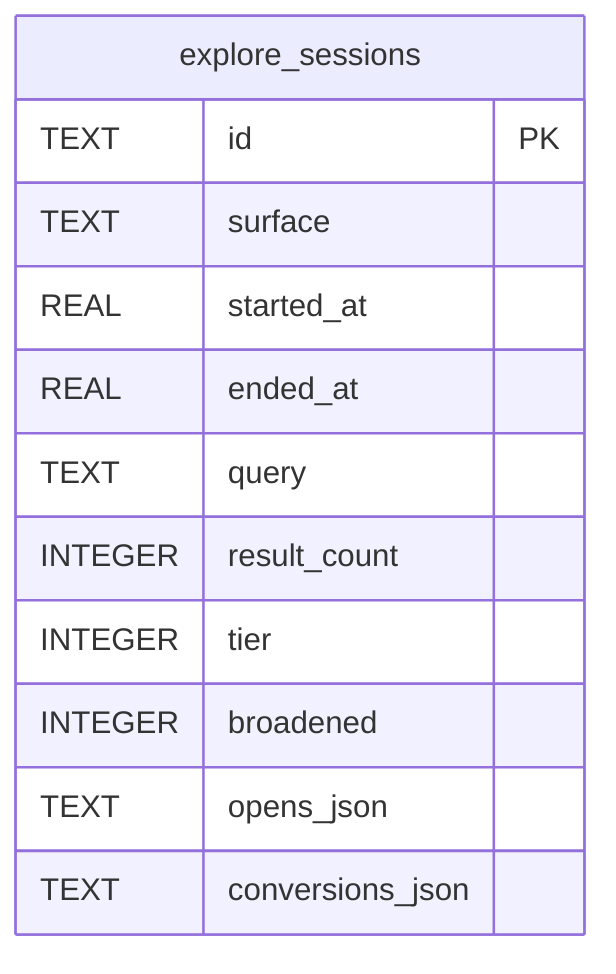

# explore_sessions

## Description

One row per visit to a browse surface (ExploreSession.swift). Not included in the backup envelope.

<details>
<summary><strong>Table Definition</strong></summary>

```sql
CREATE TABLE explore_sessions (
              id                TEXT PRIMARY KEY,
              surface           TEXT NOT NULL,
              started_at        REAL NOT NULL,
              ended_at          REAL NOT NULL,
              query             TEXT,
              result_count      INTEGER,
              tier              INTEGER,
              broadened         INTEGER NOT NULL DEFAULT 0,
              opens_json        TEXT NOT NULL DEFAULT '[]',
              conversions_json  TEXT NOT NULL DEFAULT '[]'
            )
```

</details>

## Columns

| Name             | Type    | Default | Nullable | Children | Comment |
| ---------------- | ------- | ------- | -------- | -------- | ------- |
| id               | TEXT    |         | true     |          |         |
| surface          | TEXT    |         | false    |          |         |
| started_at       | REAL    |         | false    |          |         |
| ended_at         | REAL    |         | false    |          |         |
| query            | TEXT    |         | true     |          |         |
| result_count     | INTEGER |         | true     |          |         |
| tier             | INTEGER |         | true     |          |         |
| broadened        | INTEGER | 0       | false    |          |         |
| opens_json       | TEXT    | '[]'    | false    |          |         |
| conversions_json | TEXT    | '[]'    | false    |          |         |

## Constraints

| Name                                | Type        | Definition       |
| ----------------------------------- | ----------- | ---------------- |
| id                                  | PRIMARY KEY | PRIMARY KEY (id) |
| sqlite_autoindex_explore_sessions_1 | PRIMARY KEY | PRIMARY KEY (id) |

## Indexes

| Name                                | Definition                                                                     |
| ----------------------------------- | ------------------------------------------------------------------------------ |
| idx_explore_sessions_started        | CREATE INDEX idx_explore_sessions_started ON explore_sessions(started_at DESC) |
| sqlite_autoindex_explore_sessions_1 | PRIMARY KEY (id)                                                               |

## Relations



---

> Generated by [tbls](https://github.com/k1LoW/tbls)
