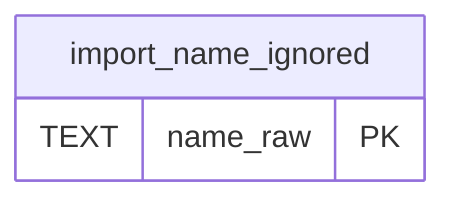

# import_name_ignored

## Description

<details>
<summary><strong>Table Definition</strong></summary>

```sql
CREATE TABLE import_name_ignored (name_raw TEXT PRIMARY KEY)
```

</details>

## Columns

| Name     | Type | Default | Nullable | Children | Comment |
| -------- | ---- | ------- | -------- | -------- | ------- |
| name_raw | TEXT |         | true     |          |         |

## Constraints

| Name                                   | Type        | Definition             |
| -------------------------------------- | ----------- | ---------------------- |
| name_raw                               | PRIMARY KEY | PRIMARY KEY (name_raw) |
| sqlite_autoindex_import_name_ignored_1 | PRIMARY KEY | PRIMARY KEY (name_raw) |

## Indexes

| Name                                   | Definition             |
| -------------------------------------- | ---------------------- |
| sqlite_autoindex_import_name_ignored_1 | PRIMARY KEY (name_raw) |

## Relations



---

> Generated by [tbls](https://github.com/k1LoW/tbls)
