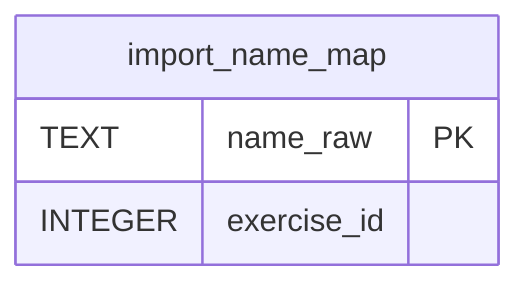

# import_name_map

## Description

<details>
<summary><strong>Table Definition</strong></summary>

```sql
CREATE TABLE import_name_map (
              name_raw     TEXT PRIMARY KEY,
              exercise_id  INTEGER NOT NULL
            )
```

</details>

## Columns

| Name        | Type    | Default | Nullable | Children | Comment |
| ----------- | ------- | ------- | -------- | -------- | ------- |
| name_raw    | TEXT    |         | true     |          |         |
| exercise_id | INTEGER |         | false    |          |         |

## Constraints

| Name                               | Type        | Definition             |
| ---------------------------------- | ----------- | ---------------------- |
| name_raw                           | PRIMARY KEY | PRIMARY KEY (name_raw) |
| sqlite_autoindex_import_name_map_1 | PRIMARY KEY | PRIMARY KEY (name_raw) |

## Indexes

| Name                               | Definition             |
| ---------------------------------- | ---------------------- |
| sqlite_autoindex_import_name_map_1 | PRIMARY KEY (name_raw) |

## Relations



---

> Generated by [tbls](https://github.com/k1LoW/tbls)
