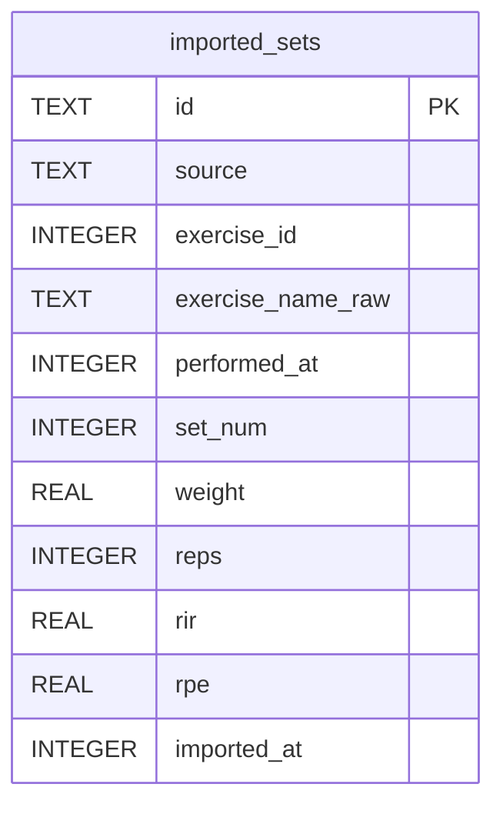

# imported_sets

## Description

Set-level CSV history. Attached to imported_workouts by performed_at proximity in Swift, not by FK.

<details>
<summary><strong>Table Definition</strong></summary>

```sql
CREATE TABLE imported_sets (
              id                   TEXT PRIMARY KEY,
              source               TEXT NOT NULL,
              exercise_id          INTEGER,
              exercise_name_raw    TEXT NOT NULL,
              performed_at         INTEGER NOT NULL,
              set_num              INTEGER NOT NULL,
              weight               REAL,
              reps                 INTEGER,
              rir                  REAL,
              rpe                  REAL,
              imported_at          INTEGER NOT NULL
            )
```

</details>

## Columns

| Name              | Type    | Default | Nullable | Children | Comment                                                           |
| ----------------- | ------- | ------- | -------- | -------- | ----------------------------------------------------------------- |
| id                | TEXT    |         | true     |          |                                                                   |
| source            | TEXT    |         | false    |          |                                                                   |
| exercise_id       | INTEGER |         | true     |          | coach.db exercises.id when the raw name fuzzy-matched, else NULL. |
| exercise_name_raw | TEXT    |         | false    |          |                                                                   |
| performed_at      | INTEGER |         | false    |          |                                                                   |
| set_num           | INTEGER |         | false    |          |                                                                   |
| weight            | REAL    |         | true     |          |                                                                   |
| reps              | INTEGER |         | true     |          |                                                                   |
| rir               | REAL    |         | true     |          |                                                                   |
| rpe               | REAL    |         | true     |          |                                                                   |
| imported_at       | INTEGER |         | false    |          |                                                                   |

## Constraints

| Name                             | Type        | Definition       |
| -------------------------------- | ----------- | ---------------- |
| id                               | PRIMARY KEY | PRIMARY KEY (id) |
| sqlite_autoindex_imported_sets_1 | PRIMARY KEY | PRIMARY KEY (id) |

## Indexes

| Name                             | Definition                                                                               |
| -------------------------------- | ---------------------------------------------------------------------------------------- |
| idx_imported_sets_source         | CREATE INDEX idx_imported_sets_source   ON imported_sets(source)                         |
| idx_imported_sets_perf           | CREATE INDEX idx_imported_sets_perf     ON imported_sets(performed_at DESC)              |
| idx_imported_sets_exercise       | CREATE INDEX idx_imported_sets_exercise ON imported_sets(exercise_id, performed_at DESC) |
| sqlite_autoindex_imported_sets_1 | PRIMARY KEY (id)                                                                         |

## Relations



---

> Generated by [tbls](https://github.com/k1LoW/tbls)
