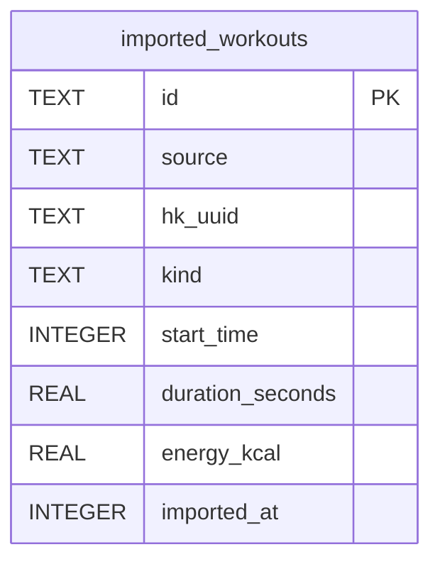

# imported_workouts

## Description

HealthKit or CSV workouts, keyed by the source's own UUID so re-import is idempotent. Unioned with sessions in GeneratorContext.

<details>
<summary><strong>Table Definition</strong></summary>

```sql
CREATE TABLE imported_workouts (
              id                TEXT PRIMARY KEY,
              source            TEXT NOT NULL,
              hk_uuid           TEXT,
              kind              TEXT NOT NULL,
              start_time        INTEGER NOT NULL,
              duration_seconds  REAL NOT NULL,
              energy_kcal       REAL,
              imported_at       INTEGER NOT NULL
            )
```

</details>

## Columns

| Name             | Type    | Default | Nullable | Children | Comment |
| ---------------- | ------- | ------- | -------- | -------- | ------- |
| id               | TEXT    |         | true     |          |         |
| source           | TEXT    |         | false    |          |         |
| hk_uuid          | TEXT    |         | true     |          |         |
| kind             | TEXT    |         | false    |          |         |
| start_time       | INTEGER |         | false    |          |         |
| duration_seconds | REAL    |         | false    |          |         |
| energy_kcal      | REAL    |         | true     |          |         |
| imported_at      | INTEGER |         | false    |          |         |

## Constraints

| Name                                 | Type        | Definition       |
| ------------------------------------ | ----------- | ---------------- |
| id                                   | PRIMARY KEY | PRIMARY KEY (id) |
| sqlite_autoindex_imported_workouts_1 | PRIMARY KEY | PRIMARY KEY (id) |

## Indexes

| Name                                 | Definition                                                                     |
| ------------------------------------ | ------------------------------------------------------------------------------ |
| idx_imported_workouts_kind           | CREATE INDEX idx_imported_workouts_kind  ON imported_workouts(kind)            |
| idx_imported_workouts_start          | CREATE INDEX idx_imported_workouts_start ON imported_workouts(start_time DESC) |
| sqlite_autoindex_imported_workouts_1 | PRIMARY KEY (id)                                                               |

## Relations



---

> Generated by [tbls](https://github.com/k1LoW/tbls)
