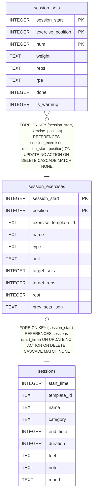

# session_exercises

## Description

<details>
<summary><strong>Table Definition</strong></summary>

```sql
CREATE TABLE session_exercises (
              session_start         INTEGER NOT NULL,
              position              INTEGER NOT NULL,
              exercise_template_id  TEXT NOT NULL,
              name                  TEXT NOT NULL,
              type                  TEXT,
              unit                  TEXT NOT NULL,
              target_sets           INTEGER NOT NULL,
              target_reps           INTEGER NOT NULL,
              rest                  INTEGER NOT NULL,
              prev_sets_json        TEXT,
              PRIMARY KEY (session_start, position),
              FOREIGN KEY (session_start) REFERENCES sessions(start_time) ON DELETE CASCADE
            )
```

</details>

## Columns

| Name                 | Type    | Default | Nullable | Children                        | Parents                 | Comment |
| -------------------- | ------- | ------- | -------- | ------------------------------- | ----------------------- | ------- |
| session_start        | INTEGER |         | false    | [session_sets](session_sets.md) | [sessions](sessions.md) |         |
| position             | INTEGER |         | false    | [session_sets](session_sets.md) |                         |         |
| exercise_template_id | TEXT    |         | false    |                                 |                         |         |
| name                 | TEXT    |         | false    |                                 |                         |         |
| type                 | TEXT    |         | true     |                                 |                         |         |
| unit                 | TEXT    |         | false    |                                 |                         |         |
| target_sets          | INTEGER |         | false    |                                 |                         |         |
| target_reps          | INTEGER |         | false    |                                 |                         |         |
| rest                 | INTEGER |         | false    |                                 |                         |         |
| prev_sets_json       | TEXT    |         | true     |                                 |                         |         |

## Constraints

| Name                                 | Type        | Definition                                                                                                    |
| ------------------------------------ | ----------- | ------------------------------------------------------------------------------------------------------------- |
| session_start                        | PRIMARY KEY | PRIMARY KEY (session_start)                                                                                   |
| position                             | PRIMARY KEY | PRIMARY KEY (position)                                                                                        |
| - (Foreign key ID: 0)                | FOREIGN KEY | FOREIGN KEY (session_start) REFERENCES sessions (start_time) ON UPDATE NO ACTION ON DELETE CASCADE MATCH NONE |
| sqlite_autoindex_session_exercises_1 | PRIMARY KEY | PRIMARY KEY (session_start, position)                                                                         |

## Indexes

| Name                                 | Definition                                                                                            |
| ------------------------------------ | ----------------------------------------------------------------------------------------------------- |
| idx_session_exercises_name           | CREATE INDEX idx_session_exercises_name ON session_exercises(name COLLATE NOCASE, session_start DESC) |
| sqlite_autoindex_session_exercises_1 | PRIMARY KEY (session_start, position)                                                                 |

## Relations



---

> Generated by [tbls](https://github.com/k1LoW/tbls)
