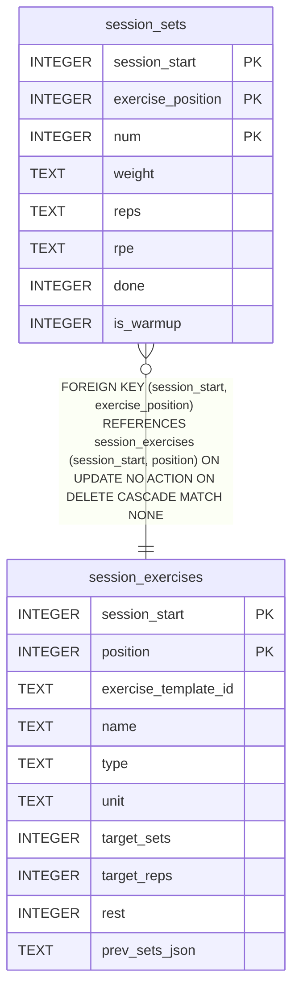

# session_sets

## Description

<details>
<summary><strong>Table Definition</strong></summary>

```sql
CREATE TABLE session_sets (
              session_start      INTEGER NOT NULL,
              exercise_position  INTEGER NOT NULL,
              num                INTEGER NOT NULL,
              weight             TEXT NOT NULL,
              reps               TEXT NOT NULL,
              rpe                TEXT NOT NULL,
              done               INTEGER NOT NULL,
              is_warmup          INTEGER NOT NULL DEFAULT 0,
              PRIMARY KEY (session_start, exercise_position, num),
              FOREIGN KEY (session_start, exercise_position)
                REFERENCES session_exercises(session_start, position) ON DELETE CASCADE
            )
```

</details>

## Columns

| Name              | Type    | Default | Nullable | Children | Parents                                   | Comment |
| ----------------- | ------- | ------- | -------- | -------- | ----------------------------------------- | ------- |
| session_start     | INTEGER |         | false    |          | [session_exercises](session_exercises.md) |         |
| exercise_position | INTEGER |         | false    |          | [session_exercises](session_exercises.md) |         |
| num               | INTEGER |         | false    |          |                                           |         |
| weight            | TEXT    |         | false    |          |                                           |         |
| reps              | TEXT    |         | false    |          |                                           |         |
| rpe               | TEXT    |         | false    |          |                                           |         |
| done              | INTEGER |         | false    |          |                                           |         |
| is_warmup         | INTEGER | 0       | false    |          |                                           |         |

## Constraints

| Name                            | Type        | Definition                                                                                                                                             |
| ------------------------------- | ----------- | ------------------------------------------------------------------------------------------------------------------------------------------------------ |
| session_start                   | PRIMARY KEY | PRIMARY KEY (session_start)                                                                                                                            |
| exercise_position               | PRIMARY KEY | PRIMARY KEY (exercise_position)                                                                                                                        |
| num                             | PRIMARY KEY | PRIMARY KEY (num)                                                                                                                                      |
| - (Foreign key ID: 0)           | FOREIGN KEY | FOREIGN KEY (session_start, exercise_position) REFERENCES session_exercises (session_start, position) ON UPDATE NO ACTION ON DELETE CASCADE MATCH NONE |
| sqlite_autoindex_session_sets_1 | PRIMARY KEY | PRIMARY KEY (session_start, exercise_position, num)                                                                                                    |

## Indexes

| Name                            | Definition                                          |
| ------------------------------- | --------------------------------------------------- |
| sqlite_autoindex_session_sets_1 | PRIMARY KEY (session_start, exercise_position, num) |

## Relations



---

> Generated by [tbls](https://github.com/k1LoW/tbls)
