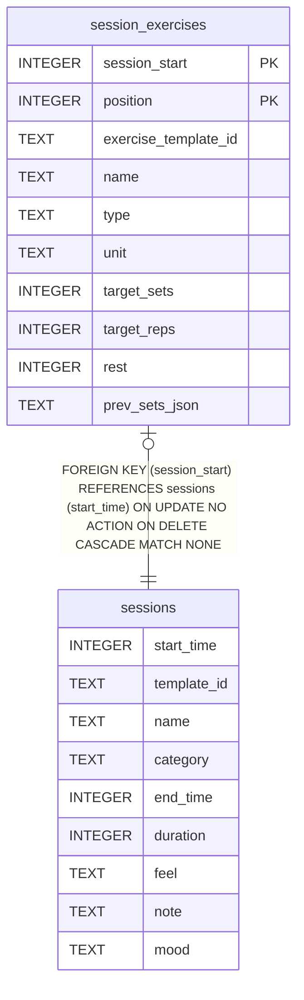

# sessions

## Description

One saved native workout. start_time (epoch seconds) is the session id, referenced from UserDefaults by DayOutcome.sessionId, WeekPlanSnapshot.actualSessionIDs and FeedbackEntry.sessionId.

<details>
<summary><strong>Table Definition</strong></summary>

```sql
CREATE TABLE sessions (
              start_time   INTEGER PRIMARY KEY,
              template_id  TEXT NOT NULL,
              name         TEXT NOT NULL,
              category     TEXT NOT NULL,
              end_time     INTEGER NOT NULL,
              duration     INTEGER NOT NULL,
              feel         TEXT,
              note         TEXT
            , mood TEXT)
```

</details>

## Columns

| Name        | Type    | Default | Nullable | Children                                  | Comment |
| ----------- | ------- | ------- | -------- | ----------------------------------------- | ------- |
| start_time  | INTEGER |         | true     | [session_exercises](session_exercises.md) |         |
| template_id | TEXT    |         | false    |                                           |         |
| name        | TEXT    |         | false    |                                           |         |
| category    | TEXT    |         | false    |                                           |         |
| end_time    | INTEGER |         | false    |                                           |         |
| duration    | INTEGER |         | false    |                                           |         |
| feel        | TEXT    |         | true     |                                           |         |
| note        | TEXT    |         | true     |                                           |         |
| mood        | TEXT    |         | true     |                                           |         |

## Constraints

| Name       | Type        | Definition               |
| ---------- | ----------- | ------------------------ |
| start_time | PRIMARY KEY | PRIMARY KEY (start_time) |

## Indexes

| Name                        | Definition                                                                         |
| --------------------------- | ---------------------------------------------------------------------------------- |
| idx_sessions_start          | CREATE INDEX idx_sessions_start ON sessions(start_time DESC)                       |
| idx_sessions_template_start | CREATE INDEX idx_sessions_template_start ON sessions(template_id, start_time DESC) |

## Relations



---

> Generated by [tbls](https://github.com/k1LoW/tbls)
