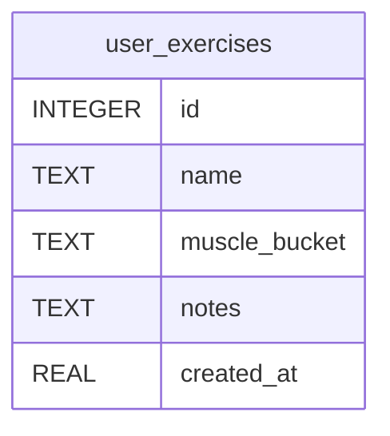

# user_exercises

## Description

<details>
<summary><strong>Table Definition</strong></summary>

```sql
CREATE TABLE user_exercises (
              id             INTEGER PRIMARY KEY AUTOINCREMENT,
              name           TEXT NOT NULL COLLATE NOCASE UNIQUE,
              muscle_bucket  TEXT,
              notes          TEXT,
              created_at     REAL NOT NULL
            )
```

</details>

## Columns

| Name          | Type    | Default | Nullable | Children | Comment |
| ------------- | ------- | ------- | -------- | -------- | ------- |
| id            | INTEGER |         | true     |          |         |
| name          | TEXT    |         | false    |          |         |
| muscle_bucket | TEXT    |         | true     |          |         |
| notes         | TEXT    |         | true     |          |         |
| created_at    | REAL    |         | false    |          |         |

## Constraints

| Name                              | Type        | Definition       |
| --------------------------------- | ----------- | ---------------- |
| id                                | PRIMARY KEY | PRIMARY KEY (id) |
| sqlite_autoindex_user_exercises_1 | UNIQUE      | UNIQUE (name)    |

## Indexes

| Name                              | Definition    |
| --------------------------------- | ------------- |
| sqlite_autoindex_user_exercises_1 | UNIQUE (name) |

## Relations



---

> Generated by [tbls](https://github.com/k1LoW/tbls)
