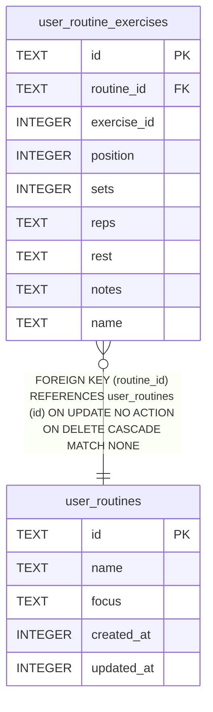

# user_routine_exercises

## Description

<details>
<summary><strong>Table Definition</strong></summary>

```sql
CREATE TABLE user_routine_exercises (
              id           TEXT PRIMARY KEY,
              routine_id   TEXT NOT NULL,
              exercise_id  INTEGER NOT NULL,
              position     INTEGER NOT NULL,
              sets         INTEGER,
              reps         TEXT,
              rest         TEXT,
              notes        TEXT,
              name         TEXT NOT NULL,
              FOREIGN KEY (routine_id) REFERENCES user_routines(id) ON DELETE CASCADE
            )
```

</details>

## Columns

| Name        | Type    | Default | Nullable | Children | Parents                           | Comment                                                  |
| ----------- | ------- | ------- | -------- | -------- | --------------------------------- | -------------------------------------------------------- |
| id          | TEXT    |         | true     |          |                                   |                                                          |
| routine_id  | TEXT    |         | false    |          | [user_routines](user_routines.md) |                                                          |
| exercise_id | INTEGER |         | false    |          |                                   | coach.db exercises.id. Separate database file, so no FK. |
| position    | INTEGER |         | false    |          |                                   |                                                          |
| sets        | INTEGER |         | true     |          |                                   |                                                          |
| reps        | TEXT    |         | true     |          |                                   |                                                          |
| rest        | TEXT    |         | true     |          |                                   |                                                          |
| notes       | TEXT    |         | true     |          |                                   |                                                          |
| name        | TEXT    |         | false    |          |                                   | Denormalized copy of the exercise name.                  |

## Constraints

| Name                                      | Type        | Definition                                                                                              |
| ----------------------------------------- | ----------- | ------------------------------------------------------------------------------------------------------- |
| id                                        | PRIMARY KEY | PRIMARY KEY (id)                                                                                        |
| - (Foreign key ID: 0)                     | FOREIGN KEY | FOREIGN KEY (routine_id) REFERENCES user_routines (id) ON UPDATE NO ACTION ON DELETE CASCADE MATCH NONE |
| sqlite_autoindex_user_routine_exercises_1 | PRIMARY KEY | PRIMARY KEY (id)                                                                                        |

## Indexes

| Name                                      | Definition                                                                   |
| ----------------------------------------- | ---------------------------------------------------------------------------- |
| idx_ure_routine                           | CREATE INDEX idx_ure_routine ON user_routine_exercises(routine_id, position) |
| sqlite_autoindex_user_routine_exercises_1 | PRIMARY KEY (id)                                                             |

## Relations



---

> Generated by [tbls](https://github.com/k1LoW/tbls)
