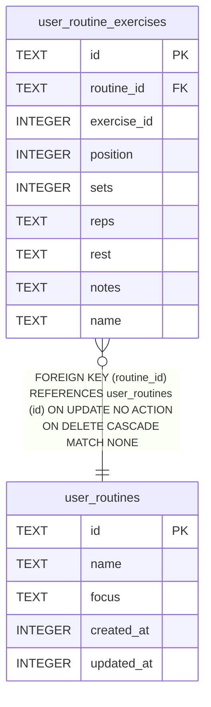

# user_routines

## Description

<details>
<summary><strong>Table Definition</strong></summary>

```sql
CREATE TABLE user_routines (
              id          TEXT PRIMARY KEY,
              name        TEXT NOT NULL,
              focus       TEXT,
              created_at  INTEGER NOT NULL,
              updated_at  INTEGER NOT NULL
            )
```

</details>

## Columns

| Name       | Type    | Default | Nullable | Children                                            | Comment |
| ---------- | ------- | ------- | -------- | --------------------------------------------------- | ------- |
| id         | TEXT    |         | true     | [user_routine_exercises](user_routine_exercises.md) |         |
| name       | TEXT    |         | false    |                                                     |         |
| focus      | TEXT    |         | true     |                                                     |         |
| created_at | INTEGER |         | false    |                                                     |         |
| updated_at | INTEGER |         | false    |                                                     |         |

## Constraints

| Name                             | Type        | Definition       |
| -------------------------------- | ----------- | ---------------- |
| id                               | PRIMARY KEY | PRIMARY KEY (id) |
| sqlite_autoindex_user_routines_1 | PRIMARY KEY | PRIMARY KEY (id) |

## Indexes

| Name                             | Definition       |
| -------------------------------- | ---------------- |
| sqlite_autoindex_user_routines_1 | PRIMARY KEY (id) |

## Relations



---

> Generated by [tbls](https://github.com/k1LoW/tbls)
